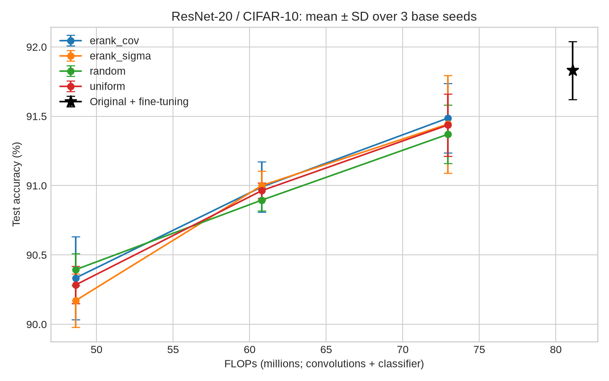
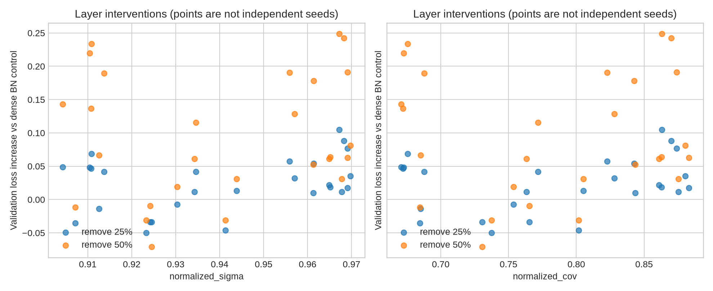
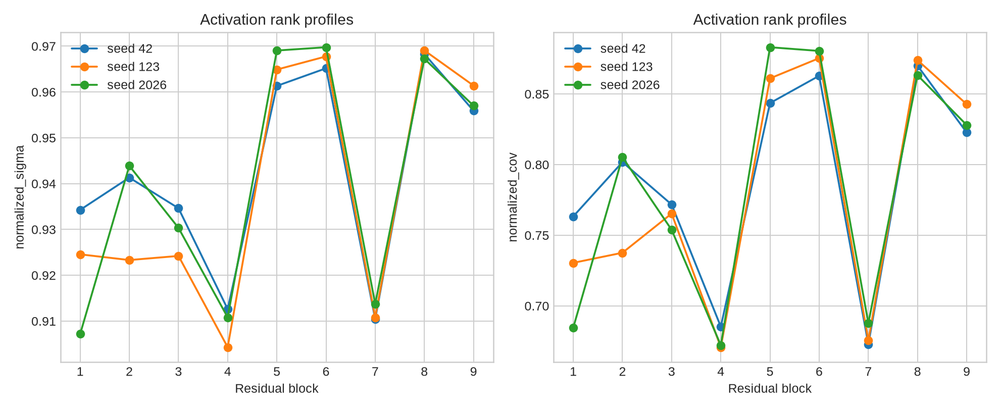

# Результаты нового пула ERank

Краткие выводы и интерпретация: [findings.md](findings.md).

Протокол: `erank_audit_v1`. Все результаты ниже получены фактическими запусками на физическом GPU 0. Исходный план: [experiment_pool_v1.md](../../experiment_pool_v1.md).

Завершено **63 обучений**, **2430 эпох**. Сумма измеренного времени обучений: **1.56 ч**; диагностика, загрузка данных и финальная оценка в эту сумму не входят.

## Основное сравнение на официальном test

`budget` — сохранённая доля FLOPs. Среднее и SD рассчитаны между тремя исходными seed; для Random две реализации сначала усредняются внутри seed. Все методы одного бюджета имеют точное совпадение MACs.

| budget | method | test_mean | test_std_between_seeds | n_seeds |
| --- | --- | --- | --- | --- |
| 0.600 | erank_cov | 90.333 | 0.300 | 3 |
| 0.600 | erank_sigma | 90.170 | 0.193 | 3 |
| 0.600 | random | 90.393 | 0.116 | 3 |
| 0.600 | uniform | 90.283 | 0.134 | 3 |
| 0.750 | erank_cov | 90.990 | 0.182 | 3 |
| 0.750 | erank_sigma | 91.000 | 0.104 | 3 |
| 0.750 | random | 90.895 | 0.078 | 3 |
| 0.750 | uniform | 90.963 | 0.055 | 3 |
| 0.900 | erank_cov | 91.487 | 0.251 | 3 |
| 0.900 | erank_sigma | 91.443 | 0.352 | 3 |
| 0.900 | random | 91.370 | 0.210 | 3 |
| 0.900 | uniform | 91.437 | 0.225 | 3 |

## Насколько различаются архитектуры

Совпадение стоимости не гарантирует сильного различия распределений ширин. Ниже показано среднее число отличающихся от Uniform блоков и сумма абсолютных различий их ширин. Нулевое расстояние означает одинаковую архитектуру.

| budget | method | different_blocks | width_l1_distance |
| --- | --- | --- | --- |
| 0.600 | erank_cov | 7.333 | 22.667 |
| 0.600 | erank_sigma | 7.000 | 11.000 |
| 0.600 | random | 7.333 | 16.333 |
| 0.750 | erank_cov | 7.667 | 23.667 |
| 0.750 | erank_sigma | 5.000 | 7.000 |
| 0.750 | random | 8.333 | 17.333 |
| 0.900 | erank_cov | 7.333 | 28.333 |
| 0.900 | erank_sigma | 4.000 | 5.000 |
| 0.900 | random | 6.500 | 9.333 |

## Парные различия относительно Uniform

Разницы выражены в процентных пунктах. Показанные интервалы основаны на трёх парных разностях и t-распределении с двумя степенями свободы, с поправкой Бонферрони на девять основных сравнений. Нормальность при таком объёме не проверяется, поэтому интервалы предварительные. Поточечные 95% интервалы сохранены в CSV. Отдельные условные bootstrap-интервалы по test-изображениям находятся в CSV и не заменяют вариативность обучения.

| budget | method_minus_uniform | mean_delta_pp | seed_fwer95_low_pp | seed_fwer95_high_pp |
| --- | --- | --- | --- | --- |
| 0.900 | erank_sigma | 0.007 | -1.879 | 1.892 |
| 0.900 | erank_cov | 0.050 | -2.422 | 2.522 |
| 0.900 | random | -0.067 | -1.490 | 1.356 |
| 0.750 | erank_sigma | 0.037 | -0.344 | 0.417 |
| 0.750 | erank_cov | 0.027 | -1.269 | 1.323 |
| 0.750 | random | -0.068 | -1.062 | 0.926 |
| 0.600 | erank_sigma | -0.113 | -0.702 | 0.476 |
| 0.600 | erank_cov | 0.050 | -1.379 | 1.479 |
| 0.600 | random | 0.110 | -0.191 | 0.411 |

Порог практической значимости зафиксирован до запуска: ±0,2 п.п. Широкий интервал означает неопределённость, а не равенство методов.

## Отбор каналов, компенсация и обучение с нуля

| phase | method | budget | test_mean | test_std | n |
| --- | --- | --- | --- | --- | --- |
| ablation | erank_sigma_compensated | 0.750 | 90.967 | 0.096 | 3 |
| ablation | erank_sigma_random_channels | 0.750 | 91.017 | 0.145 | 3 |
| base | original | 1.000 | 91.830 | 0.210 | 3 |
| dense_control | original_ft | 1.000 | 91.830 | 0.210 | 3 |
| scratch | erank_sigma | 0.750 | 91.170 | 0.223 | 3 |
| scratch | uniform | 0.750 | 91.060 | 0.325 | 3 |

Абляции используют те же ширины ERank-sigma при budget=0,75. Ниже сравниваются случайные идентичности каналов и линейная компенсация с основным QR-вариантом. Первые два столбца — validation до fine-tuning, последний — итоговый test.

| model_seed | method | raw_val_delta_pp | bn_val_delta_pp | ft_test_delta_pp |
| --- | --- | --- | --- | --- |
| 42 | erank_sigma_random_channels | -34.400 | -11.740 | -0.190 |
| 42 | erank_sigma_compensated | 21.200 | 5.320 | -0.180 |
| 123 | erank_sigma_random_channels | -16.040 | -10.740 | -0.040 |
| 123 | erank_sigma_compensated | 35.180 | 5.900 | 0.010 |
| 2026 | erank_sigma_random_channels | -23.240 | -8.240 | 0.280 |
| 2026 | erank_sigma_compensated | 17.260 | 3.300 | 0.070 |

После выбора архитектуры обучение с нуля занимает 150 эпох, а fine-tuning — 20. Для выбора ширин ERank в обоих случаях предварительно требуется 150 эпох исходной сети: полный путь ERank-scratch составляет 150 dense + 150 small, а ERank fine-tuning — 150 dense + 20 small. Uniform-scratch в таком поиске не нуждается. Равенство суммарного compute-бюджета между этими ветками не заявляется. Это уточнение учёта затрат не меняет полученных метрик.

Начальное состояние (эпоха 0) включено в выбор лучшего checkpoint по validation. В контроле Original + fine-tuning оно оказалось лучшим во всех трёх seed, поэтому его test-метрики совпадают с Original.

## Чувствительность слоёв

54 отдельных вмешательства: 9 блоков × 2 доли удаления × 3 seed. После BN сравнение проводится с несжатой моделью, прошедшей тот же пересчёт BN. Корреляции описательные; блоки одной сети не являются независимыми повторениями.

| model_seed | removed_fraction | score | n_blocks | spearman_descriptive |
| --- | --- | --- | --- | --- |
| 42 | 0.250 | normalized_sigma | 9 | 0.283 |
| 42 | 0.250 | normalized_cov | 9 | 0.283 |
| 42 | 0.500 | normalized_sigma | 9 | 0.000 |
| 42 | 0.500 | normalized_cov | 9 | 0.000 |
| 123 | 0.250 | normalized_sigma | 9 | 0.217 |
| 123 | 0.250 | normalized_cov | 9 | 0.083 |
| 123 | 0.500 | normalized_sigma | 9 | 0.050 |
| 123 | 0.500 | normalized_cov | 9 | 0.033 |
| 2026 | 0.250 | normalized_sigma | 9 | 0.250 |
| 2026 | 0.250 | normalized_cov | 9 | 0.100 |
| 2026 | 0.500 | normalized_sigma | 9 | 0.217 |
| 2026 | 0.500 | normalized_cov | 9 | 0.100 |

## Устойчивость определения ранга

В следующем контроле положительное масштабирование BN-каналов компенсируется обратным масштабированием следующей свёртки. Ранги вычислены по тем же активациям и изображениям; разница logits проверена в FP32.

| model_seed | block | original_sigma | rescaled_sigma | original_cov | rescaled_cov | max_abs_logit_difference |
| --- | --- | --- | --- | --- | --- | --- |
| 42 | 1 | 14.948140 | 7.928223 | 12.213226 | 2.785603 | 0.000008 |
| 42 | 5 | 30.762202 | 17.714488 | 26.992646 | 10.577283 | 0.000008 |
| 42 | 9 | 61.176665 | 37.023329 | 52.651740 | 22.970766 | 0.000004 |
| 123 | 1 | 14.792964 | 9.905747 | 11.687023 | 4.804474 | 0.000008 |
| 123 | 5 | 30.876247 | 17.063620 | 27.552108 | 9.883035 | 0.000006 |
| 123 | 9 | 61.528607 | 32.685861 | 53.933807 | 14.373094 | 0.000003 |
| 2026 | 1 | 14.514792 | 8.968021 | 10.954918 | 3.772837 | 0.000009 |
| 2026 | 5 | 31.009296 | 18.883574 | 28.257717 | 9.558333 | 0.000006 |
| 2026 | 9 | 61.248185 | 36.237214 | 52.990010 | 18.644263 | 0.000004 |

Оценки per-image, ограничения их максимального ранга и чувствительность к подвыборкам сохранены в `rank_profiles.csv` и `calibration_subsets.csv`. Они не использовались для выбора лучшей test-конфигурации.

## Ограничения

Три исходных seed, одна архитектура и один датасет. Random в основном сравнении условен на число удалений и точный MAC-бюджет; исходный глобальный Random без ограничения стоимости сохранён отдельно в `native_rule.csv`. Основные методы масштабируют профиль ERank под бюджет, поэтому не тождественны прямому `ceil(ERank)`. Фиксированные 20 эпох fine-tuning не доказывают достижение оптимума восстановления. Измерения аппаратного ускорения не проводились.

## Артефакты

- `results.csv`: все 63 модели, параметры, FLOPs, качество и время обучения.
- `main_per_seed.csv`, `main_summary.csv`, `paired_comparisons.csv`: основные сравнения и неопределённость.
- `architecture_contrasts.csv`: фактическое различие найденных ширин и Uniform.
- `sensitivity.csv`, `sensitivity_correlations.csv`: послойные вмешательства.
- `rank_profiles.csv`, `rescaling.csv`, `calibration_subsets.csv`: спектральная диагностика.
- `ablation_paired.csv`, `ablation_scratch_summary.csv`, `native_rule.csv`: контрольные эксперименты.
- `models/`: checkpoints, маски каналов, журналы эпох, предсказания test.
- `config.json`, `split.npz`, `environment.json`, `source_base/`, `source_pool/`, `source_report/`: воспроизведение.
