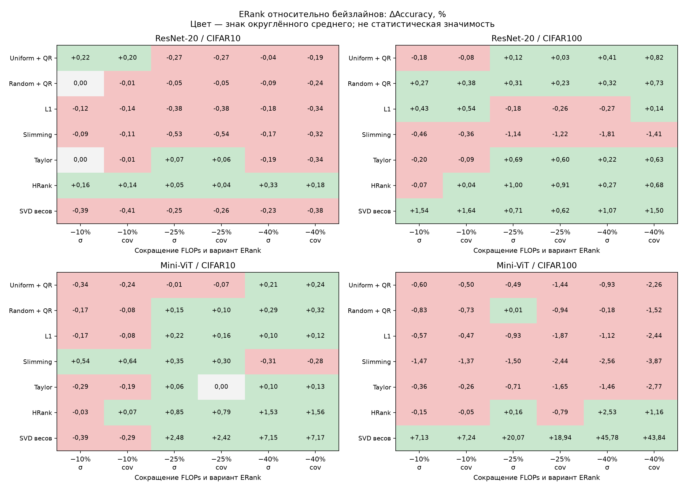
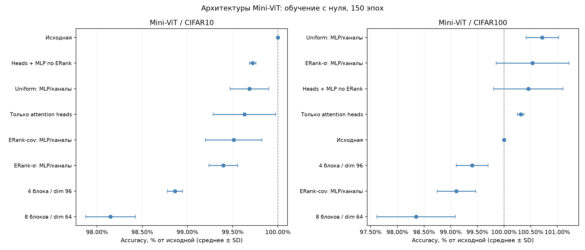

# Результаты: проценты и сравнение с бейзлайнами

Все обучения, test-оценки и замеры инференса завершены на GPU 0.
ResNet-20 и Mini-ViT × CIFAR-10/CIFAR-100; три seed; сокращение FLOPs на 10%, 25% и 40%.

## ERank и лучший бейзлайн по средней Accuracy при −25% FLOPs

| Модель | Бейзлайн с наибольшей средней Accuracy | ERank-σ: ΔAccuracy, % | ERank-cov: ΔAccuracy, % |
| --- | --- | --- | --- |
| ResNet-20 / CIFAR10 | Slimming | -0,53 ± 0,60 | -0,54 ± 0,49 |
| ResNet-20 / CIFAR100 | Slimming | -1,14 ± 0,20 | -1,22 ± 0,68 |
| Mini-ViT / CIFAR10 | Uniform + QR | -0,01 ± 0,05 | -0,07 ± 0,24 |
| Mini-ViT / CIFAR100 | Slimming | -1,50 ± 1,23 | -2,44 ± 1,07 |

Бейзлайн в этой короткой таблице выбран по средней Accuracy уже выполненных экспериментов. Это описательный ориентир, не статистически доказанный победитель. В таблицах ниже показаны все бейзлайны, включая случаи, где ERank выше по качеству. ΔAccuracy здесь — относительный процент, а не процентные пункты.

[Сравнения всех бюджетов и ресурсов](erank_vs_baselines.md) · [Полный отчёт](report.md).

## Как читать

Исходная dense-модель того же семейства, датасета и seed — точка отсчёта. Сначала вычисляются отношения внутри каждого seed, затем среднее и SD по трём seed.

| Показатель | Как читать |
| --- | --- |
| Качество, % | 100 × Accuracy / Accuracy исходной. 99% означает относительную потерю качества 1%. |
| Accuracy, % | Обычная доля правильных ответов; сохранена рядом для ориентира. |
| Loss, % | 100 × cross-entropy / cross-entropy исходной; меньше лучше. |
| Параметры и FLOPs, % | Сколько осталось от исходной модели. 75% означает сокращение на 25%. |
| Δскорости, % | 100 × (время исходной / время модели − 1). +10% — быстрее, −10% — медленнее. |
| Время, % | 100 × время модели / время исходной. 110% — инференс длится на 10% дольше. |

Проценты изменения accuracy отличаются от процентных пунктов: переход с 90% на 89,1% даёт −1% относительно прежней accuracy и −0,9 п.п. Скорость −10% соответствует времени примерно 111,1% от исходного. Отношения скорости и времени считаются отдельно до усреднения.

## Основной срез: сокращение FLOPs на 25%

Качество и ресурсы ниже нормированы на свою исходную модель. Скорость — изменение пропускной способности при batch 128; отрицательные значения означают замедление.

### ResNet-20 / CIFAR10

Исходная Accuracy: 91,68 ± 0,17%.

| Метод | Accuracy, % | Качество, % | Параметры, % | FLOPs, % | Δскорости, % (128) |
| --- | --- | --- | --- | --- | --- |
| Uniform + QR | 90,99 | 99,25 ± 0,41 | 74,4 | 74,95 | -9,8 |
| ERank-σ + QR | 90,75 | 98,99 ± 0,38 | 74,6 | 74,95 | -12,7 |
| ERank-cov + QR | 90,75 | 98,98 ± 0,23 | 75,7 | 74,95 | -15,0 |
| Random + QR | 90,80 | 99,04 ± 0,31 | 74,8 | 74,95 | -14,7 |
| L1 | 91,10 | 99,36 ± 0,33 | 74,4 | 74,95 | -9,9 |
| Taylor | 90,69 | 98,92 ± 0,16 | 74,4 | 74,95 | -10,1 |
| HRank | 90,71 | 98,94 ± 0,33 | 74,4 | 74,95 | -9,6 |
| Slimming | 91,24 | 99,52 ± 0,32 | 74,3 | 74,95 | -12,8 |
| SVD весов | 90,98 | 99,24 ± 0,49 | 85,1 | 74,92 | -13,2 |

Прямое сравнение качества ERank с каждым бейзлайном; плюс — лучше ERank:

| Бейзлайн | ERank-σ: ΔAccuracy, % | ERank-cov: ΔAccuracy, % |
| --- | --- | --- |
| Uniform + QR | -0,27 ± 0,13 | -0,27 ± 0,23 |
| Random + QR | -0,05 ± 0,09 | -0,05 ± 0,09 |
| L1 | -0,38 ± 0,39 | -0,38 ± 0,35 |
| Slimming | -0,53 ± 0,60 | -0,54 ± 0,49 |
| Taylor | +0,07 ± 0,26 | +0,06 ± 0,11 |
| HRank | +0,05 ± 0,36 | +0,04 ± 0,26 |
| SVD весов | -0,25 ± 0,32 | -0,26 ± 0,32 |

### ResNet-20 / CIFAR100

Исходная Accuracy: 66,89 ± 0,11%.

| Метод | Accuracy, % | Качество, % | Параметры, % | FLOPs, % | Δскорости, % (128) |
| --- | --- | --- | --- | --- | --- |
| Uniform + QR | 65,27 | 97,57 ± 0,51 | 75,0 | 74,96 | -9,7 |
| ERank-σ + QR | 65,34 | 97,69 ± 0,64 | 75,9 | 74,96 | -11,4 |
| ERank-cov + QR | 65,29 | 97,60 ± 0,61 | 75,7 | 74,96 | -14,7 |
| Random + QR | 65,14 | 97,38 ± 0,24 | 75,8 | 74,96 | -12,1 |
| L1 | 65,46 | 97,86 ± 0,67 | 75,0 | 74,96 | -9,9 |
| Taylor | 64,90 | 97,02 ± 0,33 | 75,0 | 74,96 | -10,0 |
| HRank | 64,70 | 96,73 ± 0,76 | 75,0 | 74,96 | -10,1 |
| Slimming | 66,10 | 98,81 ± 0,46 | 89,3 | 74,96 | -13,1 |
| SVD весов | 64,89 | 97,00 ± 0,48 | 87,1 | 74,87 | -14,2 |

Прямое сравнение качества ERank с каждым бейзлайном; плюс — лучше ERank:

| Бейзлайн | ERank-σ: ΔAccuracy, % | ERank-cov: ΔAccuracy, % |
| --- | --- | --- |
| Uniform + QR | +0,12 ± 0,15 | +0,03 ± 0,63 |
| Random + QR | +0,31 ± 0,87 | +0,23 ± 0,84 |
| L1 | -0,18 ± 0,43 | -0,26 ± 0,38 |
| Slimming | -1,14 ± 0,20 | -1,22 ± 0,68 |
| Taylor | +0,69 ± 0,93 | +0,60 ± 0,55 |
| HRank | +1,00 ± 1,40 | +0,91 ± 1,34 |
| SVD весов | +0,71 ± 1,10 | +0,62 ± 1,08 |

### Mini-ViT / CIFAR10

Исходная Accuracy: 84,32 ± 0,21%.

| Метод | Accuracy, % | Качество, % | Параметры, % | FLOPs, % | Δскорости, % (128) |
| --- | --- | --- | --- | --- | --- |
| Uniform + QR | 83,96 | 99,57 ± 0,36 | 72,7 | 74,97 | -0,8 |
| ERank-σ + QR | 83,95 | 99,56 ± 0,32 | 72,7 | 74,97 | -0,7 |
| ERank-cov + QR | 83,90 | 99,50 ± 0,16 | 72,7 | 74,97 | -0,5 |
| Random + QR | 83,82 | 99,41 ± 0,36 | 72,7 | 74,97 | -0,7 |
| L1 | 83,77 | 99,34 ± 0,61 | 72,7 | 74,97 | -0,6 |
| Taylor | 83,90 | 99,50 ± 0,27 | 72,7 | 74,97 | -0,6 |
| HRank | 83,24 | 98,72 ± 0,20 | 72,7 | 74,97 | -0,5 |
| Slimming | 83,66 | 99,21 ± 0,51 | 72,7 | 74,97 | -1,0 |
| SVD весов | 81,93 | 97,16 ± 1,19 | 72,8 | 74,97 | -12,0 |

Прямое сравнение качества ERank с каждым бейзлайном; плюс — лучше ERank:

| Бейзлайн | ERank-σ: ΔAccuracy, % | ERank-cov: ΔAccuracy, % |
| --- | --- | --- |
| Uniform + QR | -0,01 ± 0,05 | -0,07 ± 0,24 |
| Random + QR | +0,15 ± 0,07 | +0,10 ± 0,23 |
| L1 | +0,22 ± 0,53 | +0,16 ± 0,48 |
| Slimming | +0,35 ± 0,34 | +0,30 ± 0,36 |
| Taylor | +0,06 ± 0,28 | 0,00 ± 0,13 |
| HRank | +0,85 ± 0,13 | +0,79 ± 0,08 |
| SVD весов | +2,48 ± 1,39 | +2,42 ± 1,39 |

### Mini-ViT / CIFAR100

Исходная Accuracy: 58,56 ± 0,18%.

| Метод | Accuracy, % | Качество, % | Параметры, % | FLOPs, % | Δскорости, % (128) |
| --- | --- | --- | --- | --- | --- |
| Uniform + QR | 58,24 | 99,47 ± 0,45 | 73,0 | 74,98 | -0,8 |
| ERank-σ + QR | 57,96 | 98,98 ± 0,25 | 73,0 | 74,98 | -0,9 |
| ERank-cov + QR | 57,41 | 98,04 ± 0,42 | 73,0 | 74,98 | -0,7 |
| Random + QR | 57,95 | 98,97 ± 0,27 | 73,0 | 74,98 | -0,8 |
| L1 | 58,50 | 99,90 ± 0,13 | 73,0 | 74,98 | -0,9 |
| Taylor | 58,37 | 99,68 ± 0,32 | 73,0 | 74,98 | -0,8 |
| HRank | 57,86 | 98,82 ± 0,48 | 73,0 | 74,98 | -0,8 |
| Slimming | 58,85 | 100,50 ± 1,18 | 73,0 | 74,98 | -1,0 |
| SVD весов | 48,28 | 82,45 ± 1,78 | 73,1 | 74,96 | -12,2 |

Прямое сравнение качества ERank с каждым бейзлайном; плюс — лучше ERank:

| Бейзлайн | ERank-σ: ΔAccuracy, % | ERank-cov: ΔAccuracy, % |
| --- | --- | --- |
| Uniform + QR | -0,49 ± 0,57 | -1,44 ± 0,52 |
| Random + QR | +0,01 ± 0,18 | -0,94 ± 0,16 |
| L1 | -0,93 ± 0,12 | -1,87 ± 0,32 |
| Slimming | -1,50 ± 1,23 | -2,44 ± 1,07 |
| Taylor | -0,71 ± 0,27 | -1,65 ± 0,52 |
| HRank | +0,16 ± 0,42 | -0,79 ± 0,22 |
| SVD весов | +20,07 ± 2,49 | +18,94 ± 2,71 |

## Что означает сравнение

Сравнения ERank со всеми бейзлайнами добавлены после получения результатов по запросу пользователя. Они описательные: среднее ± SD трёх парных различий по одинаковым seed, без новых заявлений о статистической значимости. Первоначальные 24 проверки ERank против Uniform сохранены отдельно. В таблицах ΔAccuracy = 100 × (Accuracy ERank / Accuracy бейзлайна − 1); плюс означает преимущество ERank. Для ресурсов точкой отсчёта служит указанный бейзлайн, а не dense.

В первоначальных 24 сравнениях с поправкой Бонферрони: 0 подтверждённых преимуществ ERank и 0 подтверждённых ухудшений. Отсутствие значимости не доказывает эквивалентности; мощность при трёх seed мала. Исходные интервалы в процентных пунктах и bootstrap изображений доступны в [primary_comparisons.csv](primary_comparisons.csv). Эти проверки не пересчитывались как новые проверки относительных процентов.

Подробные сравнения параметров, FLOPs, loss и скорости относительно каждого бейзлайна: [erank_vs_baselines.md](erank_vs_baselines.md).

## Зависимость Mini-ViT от архитектуры

Все модели в этом разделе обучены с нуля 150 эпох. Исходная модель имеет полный бюджет. Для attention-only бюджет отличается от целевых 75% из-за дискретности числа heads; фактические проценты показаны. Различия средних описательные, не доказательство превосходства.

### CIFAR10

| Метод | Accuracy, % | Качество, % | Параметры, % | FLOPs, % | Δскорости, % (128) |
| --- | --- | --- | --- | --- | --- |
| Исходная | 84,32 | 100,00 ± 0,00 | 100,0 | 100,00 | 0,0 |
| Uniform: MLP/каналы | 84,06 | 99,68 ± 0,21 | 72,7 | 74,97 | -1,2 |
| ERank-σ: MLP/каналы | 83,81 | 99,40 ± 0,16 | 72,7 | 74,97 | -0,5 |
| ERank-cov: MLP/каналы | 83,91 | 99,51 ± 0,31 | 72,7 | 74,97 | -0,4 |
| Heads + MLP по ERank | 84,09 | 99,72 ± 0,04 | 76,3 | 74,97 | -0,3 |
| 8 блоков / dim 64 | 82,76 | 98,15 ± 0,28 | 73,7 | 75,00 | -24,6 |
| 4 блока / dim 96 | 83,36 | 98,86 ± 0,08 | 76,1 | 74,97 | +44,4 |
| Только attention heads | 84,01 | 99,63 ± 0,34 | 78,2 | 73,50 | +6,5 |

### CIFAR100

| Метод | Accuracy, % | Качество, % | Параметры, % | FLOPs, % | Δскорости, % (128) |
| --- | --- | --- | --- | --- | --- |
| Исходная | 58,56 | 100,00 ± 0,00 | 100,0 | 100,00 | 0,0 |
| Uniform: MLP/каналы | 58,98 | 100,72 ± 0,30 | 73,0 | 74,98 | -0,9 |
| ERank-σ: MLP/каналы | 58,87 | 100,54 ± 0,68 | 73,0 | 74,98 | -0,7 |
| ERank-cov: MLP/каналы | 58,03 | 99,11 ± 0,36 | 73,0 | 74,98 | -0,9 |
| Heads + MLP по ERank | 58,82 | 100,46 ± 0,65 | 76,6 | 74,98 | -1,2 |
| 8 блоков / dim 64 | 57,59 | 98,35 ± 0,74 | 73,6 | 75,00 | -24,6 |
| 4 блока / dim 96 | 58,21 | 99,40 ± 0,30 | 76,4 | 74,98 | +44,2 |
| Только attention heads | 58,74 | 100,31 ± 0,06 | 78,5 | 73,50 | +6,5 |

## Границы выводов

- Три seed, один split и одна калибровочная выборка дают ограниченную оценку устойчивости. SD — разброс обучений, а не доверительный интервал и не разброс отдельных изображений.
- L1, Taylor и HRank используют ширины Uniform. ERank определяет распределение ширин и использует QR. Поэтому сравнение с ними описывает полную процедуру; отдельные абляции ERank + L1/Taylor изолируют выбор каналов.
- Slimming использует отдельно обученную sparse-модель. Это другой способ подготовки весов; контроль Sparse → Uniform показан отдельно. На ViT HRank и gate-slimming являются адаптациями.
- Бюджеты совпадают по FLOPs, но не обязательно по параметрам. У SVD дискретные ранги дают небольшое отклонение FLOPs; фактическое отношение показано в сравнении. FLOPs считают Conv, Linear и attention matmul.
- Скорость относится к A100, eager/BF16, batch 1/128, deterministic cuDNN без benchmark. Вход уже на GPU; загрузка данных и копирование с CPU исключены. На другой реализации ускорение может отличаться.
- После поиска архитектуры scratch длится 150 эпох, fine-tuning — 20. ERank-scratch дополнительно требует 150 эпох исходной сети для выбора ширин; Uniform-scratch такого поиска не требует. Полный compute не уравнен.
- Три итерации ceil(ERank) не доказывают сходимости или оптимальности. Нет парного итеративного Uniform-контроля.
- CNN и ViT используют разные оптимизаторы и регуляризацию. Различия между ними нельзя приписать только архитектуре. Выводы не переносятся автоматически на большие pretrained-модели; CIFAR-10 test уже анализировался в v1.

## Данные

- [Все показатели в процентах](relative_metrics.csv).
- [Средние и SD относительных показателей](relative_summary.csv).
- [Все 168 сравнений ERank с бейзлайнами](erank_vs_baselines.csv).
- [Парные значения по seed](erank_vs_baselines_per_seed.csv).
- [Исходные абсолютные измерения](results.csv).
- [Первичные статистические проверки](primary_comparisons.csv).
