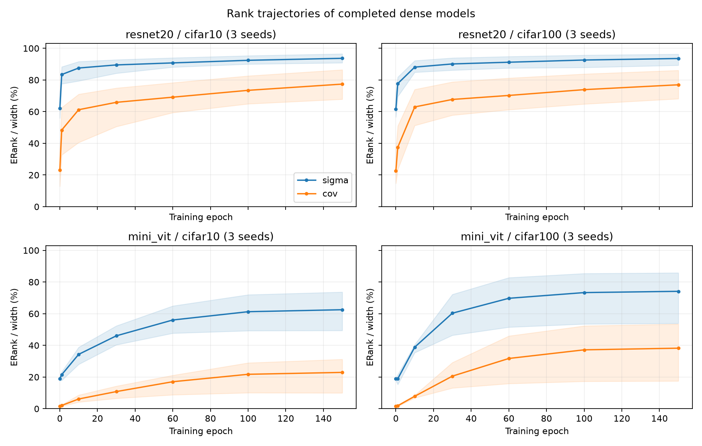

# Динамика ранга: все 12 исходных dense-моделей

Все базовые dense-обучения завершены. Точки — среднее нормированного ранга по блокам и трём seed; полосы — минимум и максимум послойных средних, а не доверительные интервалы. Использованы фиксированные 256 calibration-изображений. Test не используется.

Ранг измерен в состоянии модели на указанной эпохе. Основные эксперименты сжатия отдельно используют лучший validation-checkpoint и 1024 calibration-изображения; эти оценки могут отличаться.

| Модель | Датасет | Seed | Sigma / width, %, эпоха 0 | Эпоха 150, % | Cov / width, %, эпоха 0 | Эпоха 150, % |
| --- | --- | --- | --- | --- | --- | --- |
| resnet20 | cifar10 | 42, 123, 2026 | 62.1 | 93.7 | 23.1 | 77.4 |
| resnet20 | cifar100 | 42, 123, 2026 | 61.7 | 93.6 | 22.6 | 77.0 |
| mini_vit | cifar10 | 42, 123, 2026 | 19.0 | 62.5 | 1.6 | 22.9 |
| mini_vit | cifar100 | 42, 123, 2026 | 19.0 | 74.1 | 1.5 | 38.2 |

ERank-sigma и ERank-cov используют один центрированный массив активаций; веса спектра равны sigma и sigma² соответственно. Значения не являются доказательством возможности удалить соответствующую долю каналов без потери качества.

Исходные послойные данные: `models/*_dense/rank_dynamics/e*.json`. Аналогичные семь измерений сохранены для всех 12 sparse-моделей. Эта страница описывает только динамику базовых моделей; состояние полного сравнения методов сжатия указано в [progress.md](progress.md).
