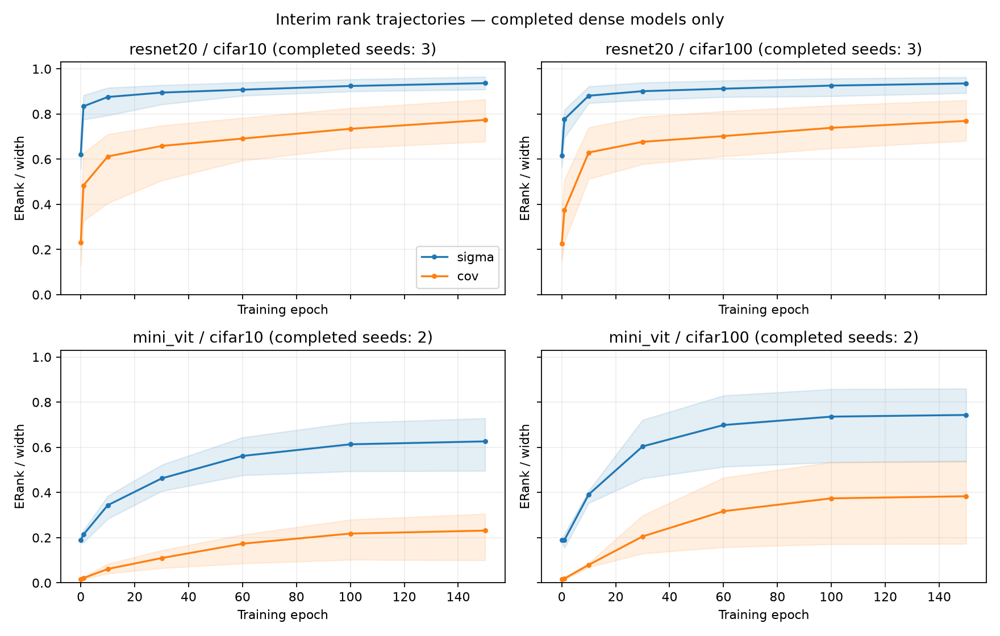

# Промежуточная динамика ранга

Только завершённые dense-обучения; test не используется. Точки — среднее нормированного ранга по блокам и доступным seed. Полосы — минимум и максимум послойных средних, а не доверительные интервалы. Это описание траекторий, не проверка качества сжатия.

| Модель | Датасет | Завершённых seed | ERank-sigma / width, эпоха 0 | Эпоха 150 | ERank-cov / width, эпоха 0 | Эпоха 150 |
| --- | --- | --- | --- | --- | --- | --- |
| resnet20 | cifar10 | 3 | 0.621 | 0.937 | 0.231 | 0.774 |
| resnet20 | cifar100 | 3 | 0.617 | 0.936 | 0.226 | 0.770 |
| mini_vit | cifar10 | 2 | 0.190 | 0.626 | 0.016 | 0.231 |
| mini_vit | cifar100 | 2 | 0.190 | 0.743 | 0.016 | 0.383 |

ERank-sigma и ERank-cov используют один и тот же центрированный массив активаций; различаются весами спектра (sigma и sigma²). Понижение ранга в этой таблице не доказывает возможность удаления соответствующей доли каналов без потери качества.
