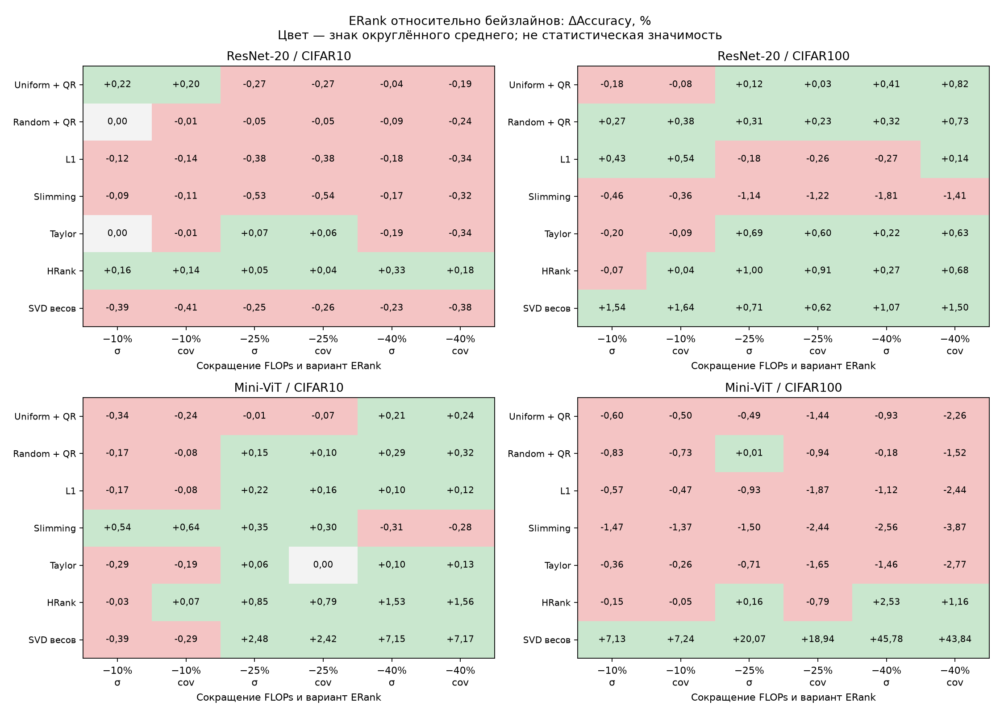
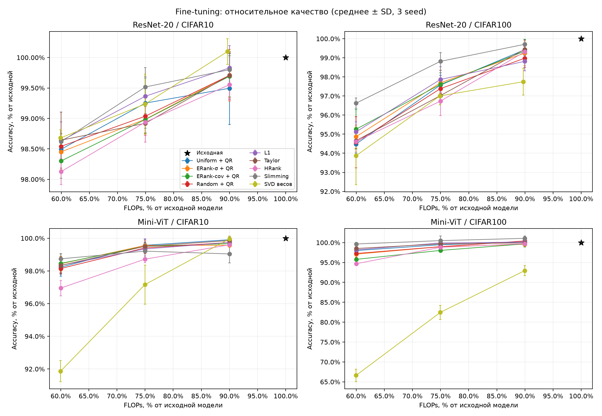
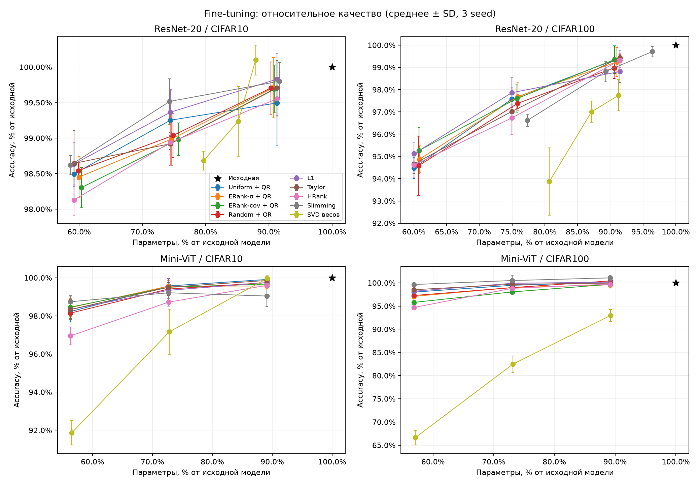
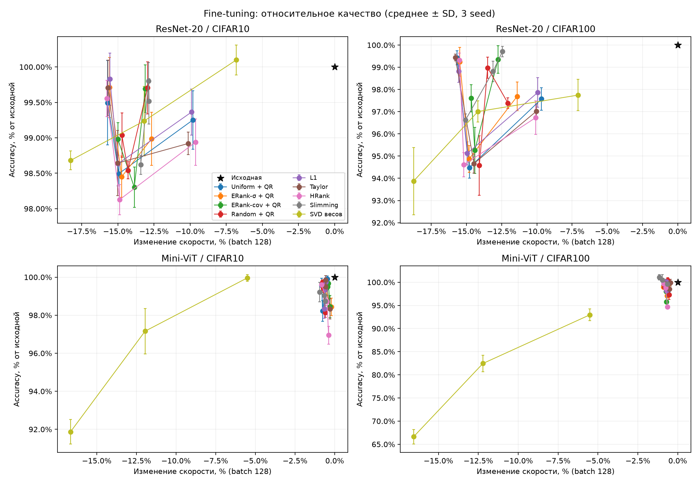
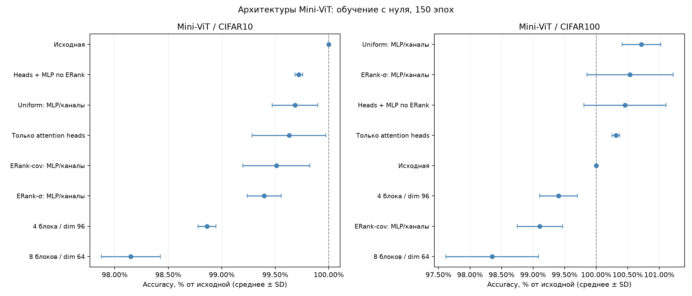
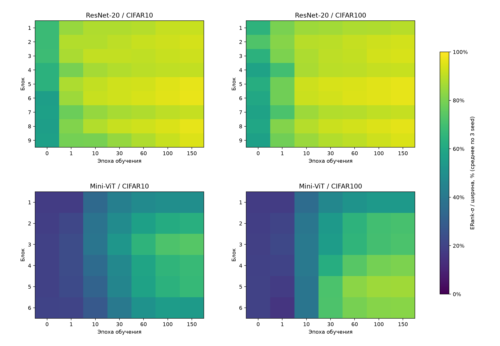

# Полный отчёт: относительные метрики

Все обучения, test-оценки и замеры инференса завершены на GPU 0.
ResNet-20 и Mini-ViT × CIFAR-10/CIFAR-100; три seed; сокращение FLOPs на 10%, 25% и 40%.

[Краткая сводка](findings.md) · [Все прямые сравнения ERank](erank_vs_baselines.md) · [План](../../experiment_pool_v2.md)

## Единицы и точка отсчёта

Исходная dense-модель того же семейства, датасета и seed — точка отсчёта. Сначала вычисляются отношения внутри каждого seed, затем среднее и SD по трём seed.

| Показатель | Как читать |
| --- | --- |
| Качество, % | 100 × Accuracy / Accuracy исходной. 99% означает относительную потерю качества 1%. |
| Accuracy, % | Обычная доля правильных ответов; сохранена рядом для ориентира. |
| Loss, % | 100 × cross-entropy / cross-entropy исходной; меньше лучше. |
| Параметры и FLOPs, % | Сколько осталось от исходной модели. 75% означает сокращение на 25%. |
| Δскорости, % | 100 × (время исходной / время модели − 1). +10% — быстрее, −10% — медленнее. |
| Время, % | 100 × время модели / время исходной. 110% — инференс длится на 10% дольше. |

Проценты изменения accuracy отличаются от процентных пунктов: переход с 90% на 89,1% даёт −1% относительно прежней accuracy и −0,9 п.п. Скорость −10% соответствует времени примерно 111,1% от исходного. Отношения скорости и времени считаются отдельно до усреднения.

В таблицах качества приведены среднее ± SD. В таблицах ресурсов — средние отношения. Для batch 1 и 128 используются одни и те же сохранённые замеры; новые обучения не запускались.

## Исходные модели и sparse-контроли

### ResNet-20 / CIFAR10

| Метод | Accuracy, % | Качество, % от исходной | Loss, % от исходной |
| --- | --- | --- | --- |
| Исходная | 91,68 ± 0,17 | 100,00 ± 0,00 | 100,00 ± 0,00 |
| Исходная + sparsity | 91,93 ± 0,17 | 100,27 ± 0,25 | 94,67 ± 1,70 |

| Метод | Параметры, % | FLOPs, % | Δскорости, % (1) | Δскорости, % (128) | Время, % (128) |
| --- | --- | --- | --- | --- | --- |
| Исходная | 100,0 | 100,00 | 0,0 | 0,0 | 100,0 |
| Исходная + sparsity | 100,0 | 100,00 | 0,0 | +0,1 | 99,9 |

### ResNet-20 / CIFAR100

| Метод | Accuracy, % | Качество, % от исходной | Loss, % от исходной |
| --- | --- | --- | --- |
| Исходная | 66,89 ± 0,11 | 100,00 ± 0,00 | 100,00 ± 0,00 |
| Исходная + sparsity | 67,07 ± 0,51 | 100,27 ± 0,87 | 100,22 ± 1,21 |

| Метод | Параметры, % | FLOPs, % | Δскорости, % (1) | Δскорости, % (128) | Время, % (128) |
| --- | --- | --- | --- | --- | --- |
| Исходная | 100,0 | 100,00 | 0,0 | 0,0 | 100,0 |
| Исходная + sparsity | 100,0 | 100,00 | -0,1 | 0,0 | 100,0 |

### Mini-ViT / CIFAR10

| Метод | Accuracy, % | Качество, % от исходной | Loss, % от исходной |
| --- | --- | --- | --- |
| Исходная | 84,32 ± 0,21 | 100,00 ± 0,00 | 100,00 ± 0,00 |
| Исходная + sparsity | 83,63 ± 0,25 | 99,18 ± 0,53 | 101,79 ± 1,93 |

| Метод | Параметры, % | FLOPs, % | Δскорости, % (1) | Δскорости, % (128) | Время, % (128) |
| --- | --- | --- | --- | --- | --- |
| Исходная | 100,0 | 100,00 | 0,0 | 0,0 | 100,0 |
| Исходная + sparsity | 100,3 | 100,00 | +0,3 | -0,1 | 100,1 |

### Mini-ViT / CIFAR100

| Метод | Accuracy, % | Качество, % от исходной | Loss, % от исходной |
| --- | --- | --- | --- |
| Исходная | 58,56 ± 0,18 | 100,00 ± 0,00 | 100,00 ± 0,00 |
| Исходная + sparsity | 59,14 ± 0,12 | 101,00 ± 0,51 | 98,07 ± 1,50 |

| Метод | Параметры, % | FLOPs, % | Δскорости, % (1) | Δскорости, % (128) | Время, % (128) |
| --- | --- | --- | --- | --- | --- |
| Исходная | 100,0 | 100,00 | 0,0 | 0,0 | 100,0 |
| Исходная + sparsity | 100,3 | 100,00 | +0,1 | -0,3 | 100,3 |

## Основные сравнения при одинаковом бюджете FLOPs

Для ViT Slimming означает gate-slimming, HRank использует карты patch-grid. SVD может немного отклоняться от целевого бюджета; в таблицах приведён фактический процент.

### ResNet-20 / CIFAR10

Исходная Accuracy: 91,68 ± 0,17%.

#### FLOPs: осталось 90%, сокращение 10%

| Метод | Accuracy, % | Качество, % от исходной | Loss, % от исходной |
| --- | --- | --- | --- |
| Uniform + QR | 91,22 ± 0,51 | 99,49 ± 0,60 | 101,74 ± 3,13 |
| ERank-σ + QR | 91,41 ± 0,27 | 99,71 ± 0,42 | 100,48 ± 1,16 |
| ERank-cov + QR | 91,40 ± 0,15 | 99,69 ± 0,34 | 100,76 ± 2,98 |
| Random + QR | 91,41 ± 0,27 | 99,71 ± 0,37 | 99,63 ± 0,57 |
| L1 | 91,52 ± 0,18 | 99,83 ± 0,37 | 99,94 ± 1,22 |
| Taylor | 91,41 ± 0,25 | 99,71 ± 0,39 | 99,39 ± 1,09 |
| HRank | 91,27 ± 0,14 | 99,55 ± 0,26 | 100,59 ± 1,61 |
| Slimming | 91,50 ± 0,07 | 99,80 ± 0,26 | 99,02 ± 0,64 |
| SVD весов | 91,77 ± 0,10 | 100,10 ± 0,21 | 100,15 ± 1,61 |

| Метод | Параметры, % | FLOPs, % | Δскорости, % (1) | Δскорости, % (128) | Время, % (128) |
| --- | --- | --- | --- | --- | --- |
| Uniform + QR | 91,3 | 89,95 | -14,4 | -15,7 | 118,6 |
| ERank-σ + QR | 90,7 | 89,95 | -14,4 | -15,6 | 118,4 |
| ERank-cov + QR | 90,8 | 89,95 | -11,2 | -13,1 | 115,1 |
| Random + QR | 90,3 | 89,95 | -12,0 | -12,9 | 114,9 |
| L1 | 91,3 | 89,95 | -14,3 | -15,5 | 118,4 |
| Taylor | 91,3 | 89,95 | -14,4 | -15,7 | 118,6 |
| HRank | 91,3 | 89,95 | -14,6 | -15,8 | 118,7 |
| Slimming | 91,7 | 89,95 | -12,0 | -12,9 | 114,8 |
| SVD весов | 87,9 | 89,62 | -5,4 | -6,8 | 107,3 |

ERank против каждого бейзлайна: относительное изменение Accuracy, %.

| Бейзлайн | ERank-σ: ΔAccuracy, % | ERank-cov: ΔAccuracy, % |
| --- | --- | --- |
| Uniform + QR | +0,22 ± 0,32 | +0,20 ± 0,50 |
| Random + QR | 0,00 ± 0,13 | -0,01 ± 0,25 |
| L1 | -0,12 ± 0,14 | -0,14 ± 0,04 |
| Slimming | -0,09 ± 0,27 | -0,11 ± 0,11 |
| Taylor | 0,00 ± 0,50 | -0,01 ± 0,32 |
| HRank | +0,16 ± 0,17 | +0,14 ± 0,14 |
| SVD весов | -0,39 ± 0,21 | -0,41 ± 0,16 |

#### FLOPs: осталось 75%, сокращение 25%

| Метод | Accuracy, % | Качество, % от исходной | Loss, % от исходной |
| --- | --- | --- | --- |
| Uniform + QR | 90,99 ± 0,21 | 99,25 ± 0,41 | 99,19 ± 1,31 |
| ERank-σ + QR | 90,75 ± 0,21 | 98,99 ± 0,38 | 101,12 ± 0,47 |
| ERank-cov + QR | 90,75 ± 0,13 | 98,98 ± 0,23 | 100,96 ± 3,35 |
| Random + QR | 90,80 ± 0,19 | 99,04 ± 0,31 | 101,04 ± 0,72 |
| L1 | 91,10 ± 0,20 | 99,36 ± 0,33 | 98,01 ± 1,81 |
| Taylor | 90,69 ± 0,17 | 98,92 ± 0,16 | 101,03 ± 2,31 |
| HRank | 90,71 ± 0,34 | 98,94 ± 0,33 | 101,63 ± 4,27 |
| Slimming | 91,24 ± 0,34 | 99,52 ± 0,32 | 98,83 ± 2,50 |
| SVD весов | 90,98 ± 0,42 | 99,24 ± 0,49 | 105,60 ± 4,05 |

| Метод | Параметры, % | FLOPs, % | Δскорости, % (1) | Δскорости, % (128) | Время, % (128) |
| --- | --- | --- | --- | --- | --- |
| Uniform + QR | 74,4 | 74,95 | -8,0 | -9,8 | 110,9 |
| ERank-σ + QR | 74,6 | 74,95 | -10,5 | -12,7 | 114,5 |
| ERank-cov + QR | 75,7 | 74,95 | -12,9 | -15,0 | 117,7 |
| Random + QR | 74,8 | 74,95 | -13,6 | -14,7 | 117,3 |
| L1 | 74,4 | 74,95 | -8,1 | -9,9 | 111,0 |
| Taylor | 74,4 | 74,95 | -8,2 | -10,1 | 111,3 |
| HRank | 74,4 | 74,95 | -8,2 | -9,6 | 110,7 |
| Slimming | 74,3 | 74,95 | -11,9 | -12,8 | 114,8 |
| SVD весов | 85,1 | 74,92 | -10,1 | -13,2 | 115,2 |

ERank против каждого бейзлайна: относительное изменение Accuracy, %.

| Бейзлайн | ERank-σ: ΔAccuracy, % | ERank-cov: ΔAccuracy, % |
| --- | --- | --- |
| Uniform + QR | -0,27 ± 0,13 | -0,27 ± 0,23 |
| Random + QR | -0,05 ± 0,09 | -0,05 ± 0,09 |
| L1 | -0,38 ± 0,39 | -0,38 ± 0,35 |
| Slimming | -0,53 ± 0,60 | -0,54 ± 0,49 |
| Taylor | +0,07 ± 0,26 | +0,06 ± 0,11 |
| HRank | +0,05 ± 0,36 | +0,04 ± 0,26 |
| SVD весов | -0,25 ± 0,32 | -0,26 ± 0,32 |

#### FLOPs: осталось 60%, сокращение 40%

| Метод | Accuracy, % | Качество, % от исходной | Loss, % от исходной |
| --- | --- | --- | --- |
| Uniform + QR | 90,30 ± 0,29 | 98,49 ± 0,16 | 102,18 ± 0,31 |
| ERank-σ + QR | 90,26 ± 0,17 | 98,45 ± 0,29 | 102,22 ± 1,32 |
| ERank-cov + QR | 90,12 ± 0,13 | 98,30 ± 0,28 | 102,18 ± 1,51 |
| Random + QR | 90,34 ± 0,16 | 98,54 ± 0,12 | 101,39 ± 0,93 |
| L1 | 90,43 ± 0,12 | 98,63 ± 0,31 | 101,26 ± 1,76 |
| Taylor | 90,44 ± 0,53 | 98,64 ± 0,46 | 101,71 ± 5,29 |
| HRank | 89,96 ± 0,03 | 98,13 ± 0,21 | 102,08 ± 1,54 |
| Slimming | 90,41 ± 0,08 | 98,62 ± 0,13 | 102,59 ± 1,09 |
| SVD весов | 90,47 ± 0,22 | 98,68 ± 0,13 | 104,13 ± 4,03 |

| Метод | Параметры, % | FLOPs, % | Δскорости, % (1) | Δскорости, % (128) | Время, % (128) |
| --- | --- | --- | --- | --- | --- |
| Uniform + QR | 59,2 | 59,96 | -13,8 | -14,9 | 117,5 |
| ERank-σ + QR | 60,0 | 59,96 | -13,4 | -14,7 | 117,3 |
| ERank-cov + QR | 60,3 | 59,96 | -12,7 | -13,9 | 116,1 |
| Random + QR | 59,9 | 59,96 | -12,7 | -14,3 | 116,7 |
| L1 | 59,2 | 59,96 | -13,6 | -15,0 | 117,6 |
| Taylor | 59,2 | 59,96 | -13,7 | -15,0 | 117,7 |
| HRank | 59,2 | 59,96 | -13,5 | -14,9 | 117,5 |
| Slimming | 58,6 | 59,96 | -12,2 | -13,4 | 115,5 |
| SVD весов | 79,7 | 59,86 | -13,8 | -18,3 | 122,4 |

ERank против каждого бейзлайна: относительное изменение Accuracy, %.

| Бейзлайн | ERank-σ: ΔAccuracy, % | ERank-cov: ΔAccuracy, % |
| --- | --- | --- |
| Uniform + QR | -0,04 ± 0,36 | -0,19 ± 0,44 |
| Random + QR | -0,09 ± 0,20 | -0,24 ± 0,32 |
| L1 | -0,18 ± 0,18 | -0,34 ± 0,15 |
| Slimming | -0,17 ± 0,27 | -0,32 ± 0,15 |
| Taylor | -0,19 ± 0,52 | -0,34 ± 0,72 |
| HRank | +0,33 ± 0,18 | +0,18 ± 0,14 |
| SVD весов | -0,23 ± 0,25 | -0,38 ± 0,38 |

### ResNet-20 / CIFAR100

Исходная Accuracy: 66,89 ± 0,11%.

#### FLOPs: осталось 90%, сокращение 10%

| Метод | Accuracy, % | Качество, % от исходной | Loss, % от исходной |
| --- | --- | --- | --- |
| Uniform + QR | 66,50 ± 0,16 | 99,42 ± 0,32 | 100,58 ± 1,27 |
| ERank-σ + QR | 66,38 ± 0,33 | 99,24 ± 0,65 | 100,60 ± 1,17 |
| ERank-cov + QR | 66,45 ± 0,32 | 99,35 ± 0,62 | 100,86 ± 0,92 |
| Random + QR | 66,21 ± 0,32 | 98,98 ± 0,48 | 101,35 ± 0,56 |
| L1 | 66,10 ± 0,26 | 98,81 ± 0,49 | 101,24 ± 1,00 |
| Taylor | 66,52 ± 0,05 | 99,44 ± 0,15 | 100,22 ± 0,77 |
| HRank | 66,43 ± 0,11 | 99,31 ± 0,33 | 100,44 ± 0,37 |
| Slimming | 66,69 ± 0,10 | 99,71 ± 0,23 | 100,67 ± 0,57 |
| SVD весов | 65,38 ± 0,56 | 97,75 ± 0,70 | 104,20 ± 1,30 |

| Метод | Параметры, % | FLOPs, % | Δскорости, % (1) | Δскорости, % (128) | Время, % (128) |
| --- | --- | --- | --- | --- | --- |
| Uniform + QR | 91,5 | 89,96 | -14,4 | -15,7 | 118,6 |
| ERank-σ + QR | 91,0 | 89,96 | -14,2 | -15,5 | 118,3 |
| ERank-cov + QR | 90,6 | 89,96 | -11,4 | -12,8 | 114,7 |
| Random + QR | 90,6 | 89,96 | -12,4 | -13,5 | 115,6 |
| L1 | 91,5 | 89,96 | -14,4 | -15,6 | 118,4 |
| Taylor | 91,5 | 89,96 | -14,5 | -15,8 | 118,8 |
| HRank | 91,5 | 89,96 | -14,2 | -15,5 | 118,3 |
| Slimming | 96,4 | 89,96 | -11,0 | -12,4 | 114,2 |
| SVD весов | 91,3 | 89,72 | -5,4 | -7,1 | 107,6 |

ERank против каждого бейзлайна: относительное изменение Accuracy, %.

| Бейзлайн | ERank-σ: ΔAccuracy, % | ERank-cov: ΔAccuracy, % |
| --- | --- | --- |
| Uniform + QR | -0,18 ± 0,54 | -0,08 ± 0,32 |
| Random + QR | +0,27 ± 0,70 | +0,38 ± 0,91 |
| L1 | +0,43 ± 0,37 | +0,54 ± 0,66 |
| Slimming | -0,46 ± 0,49 | -0,36 ± 0,59 |
| Taylor | -0,20 ± 0,52 | -0,09 ± 0,55 |
| HRank | -0,07 ± 0,33 | +0,04 ± 0,44 |
| SVD весов | +1,54 ± 1,34 | +1,64 ± 1,12 |

#### FLOPs: осталось 75%, сокращение 25%

| Метод | Accuracy, % | Качество, % от исходной | Loss, % от исходной |
| --- | --- | --- | --- |
| Uniform + QR | 65,27 ± 0,26 | 97,57 ± 0,51 | 101,20 ± 1,14 |
| ERank-σ + QR | 65,34 ± 0,35 | 97,69 ± 0,64 | 100,88 ± 1,15 |
| ERank-cov + QR | 65,29 ± 0,32 | 97,60 ± 0,61 | 100,95 ± 2,33 |
| Random + QR | 65,14 ± 0,27 | 97,38 ± 0,24 | 101,61 ± 1,77 |
| L1 | 65,46 ± 0,34 | 97,86 ± 0,67 | 100,30 ± 1,30 |
| Taylor | 64,90 ± 0,25 | 97,02 ± 0,33 | 100,79 ± 1,61 |
| HRank | 64,70 ± 0,61 | 96,73 ± 0,76 | 100,30 ± 1,36 |
| Slimming | 66,10 ± 0,25 | 98,81 ± 0,46 | 100,61 ± 0,83 |
| SVD весов | 64,89 ± 0,43 | 97,00 ± 0,48 | 104,45 ± 0,96 |

| Метод | Параметры, % | FLOPs, % | Δскорости, % (1) | Δскорости, % (128) | Время, % (128) |
| --- | --- | --- | --- | --- | --- |
| Uniform + QR | 75,0 | 74,96 | -8,0 | -9,7 | 110,7 |
| ERank-σ + QR | 75,9 | 74,96 | -10,0 | -11,4 | 112,9 |
| ERank-cov + QR | 75,7 | 74,96 | -12,7 | -14,7 | 117,2 |
| Random + QR | 75,8 | 74,96 | -10,4 | -12,1 | 113,7 |
| L1 | 75,0 | 74,96 | -8,4 | -9,9 | 111,0 |
| Taylor | 75,0 | 74,96 | -8,5 | -10,0 | 111,2 |
| HRank | 75,0 | 74,96 | -8,5 | -10,1 | 111,2 |
| Slimming | 89,3 | 74,96 | -12,0 | -13,1 | 115,1 |
| SVD весов | 87,1 | 74,87 | -9,7 | -14,2 | 116,5 |

ERank против каждого бейзлайна: относительное изменение Accuracy, %.

| Бейзлайн | ERank-σ: ΔAccuracy, % | ERank-cov: ΔAccuracy, % |
| --- | --- | --- |
| Uniform + QR | +0,12 ± 0,15 | +0,03 ± 0,63 |
| Random + QR | +0,31 ± 0,87 | +0,23 ± 0,84 |
| L1 | -0,18 ± 0,43 | -0,26 ± 0,38 |
| Slimming | -1,14 ± 0,20 | -1,22 ± 0,68 |
| Taylor | +0,69 ± 0,93 | +0,60 ± 0,55 |
| HRank | +1,00 ± 1,40 | +0,91 ± 1,34 |
| SVD весов | +0,71 ± 1,10 | +0,62 ± 1,08 |

#### FLOPs: осталось 60%, сокращение 40%

| Метод | Accuracy, % | Качество, % от исходной | Loss, % от исходной |
| --- | --- | --- | --- |
| Uniform + QR | 63,20 ± 0,35 | 94,48 ± 0,48 | 103,86 ± 1,53 |
| ERank-σ + QR | 63,46 ± 0,40 | 94,87 ± 0,60 | 104,20 ± 2,28 |
| ERank-cov + QR | 63,72 ± 0,75 | 95,26 ± 1,04 | 103,63 ± 2,35 |
| Random + QR | 63,26 ± 0,96 | 94,58 ± 1,34 | 104,43 ± 3,01 |
| L1 | 63,63 ± 0,34 | 95,12 ± 0,53 | 102,84 ± 2,17 |
| Taylor | 63,32 ± 0,39 | 94,66 ± 0,43 | 103,70 ± 1,49 |
| HRank | 63,29 ± 0,33 | 94,61 ± 0,55 | 103,97 ± 1,65 |
| Slimming | 64,63 ± 0,20 | 96,62 ± 0,27 | 102,44 ± 0,23 |
| SVD весов | 62,79 ± 0,91 | 93,87 ± 1,51 | 107,90 ± 2,34 |

| Метод | Параметры, % | FLOPs, % | Δскорости, % (1) | Δскорости, % (128) | Время, % (128) |
| --- | --- | --- | --- | --- | --- |
| Uniform + QR | 60,0 | 59,96 | -13,4 | -14,8 | 117,4 |
| ERank-σ + QR | 60,8 | 59,96 | -13,6 | -14,8 | 117,4 |
| ERank-cov + QR | 60,8 | 59,96 | -13,2 | -14,4 | 116,8 |
| Random + QR | 60,7 | 59,96 | -12,3 | -14,1 | 116,4 |
| L1 | 60,0 | 59,96 | -13,6 | -14,9 | 117,6 |
| Taylor | 60,0 | 59,96 | -13,1 | -14,5 | 116,9 |
| HRank | 60,0 | 59,96 | -13,7 | -15,2 | 117,9 |
| Slimming | 77,4 | 59,96 | -13,7 | -15,1 | 117,7 |
| SVD весов | 80,7 | 59,97 | -13,9 | -18,8 | 123,1 |

ERank против каждого бейзлайна: относительное изменение Accuracy, %.

| Бейзлайн | ERank-σ: ΔAccuracy, % | ERank-cov: ΔAccuracy, % |
| --- | --- | --- |
| Uniform + QR | +0,41 ± 0,21 | +0,82 ± 0,64 |
| Random + QR | +0,32 ± 1,05 | +0,73 ± 0,36 |
| L1 | -0,27 ± 0,08 | +0,14 ± 0,76 |
| Slimming | -1,81 ± 0,89 | -1,41 ± 1,34 |
| Taylor | +0,22 ± 0,72 | +0,63 ± 0,82 |
| HRank | +0,27 ± 0,19 | +0,68 ± 0,90 |
| SVD весов | +1,07 ± 1,51 | +1,50 ± 2,21 |

### Mini-ViT / CIFAR10

Исходная Accuracy: 84,32 ± 0,21%.

#### FLOPs: осталось 90%, сокращение 10%

| Метод | Accuracy, % | Качество, % от исходной | Loss, % от исходной |
| --- | --- | --- | --- |
| Uniform + QR | 84,25 ± 0,12 | 99,91 ± 0,15 | 100,52 ± 2,04 |
| ERank-σ + QR | 83,96 ± 0,25 | 99,57 ± 0,08 | 100,22 ± 1,14 |
| ERank-cov + QR | 84,04 ± 0,17 | 99,67 ± 0,07 | 99,25 ± 1,43 |
| Random + QR | 84,11 ± 0,12 | 99,74 ± 0,11 | 100,10 ± 1,93 |
| L1 | 84,11 ± 0,09 | 99,74 ± 0,23 | 100,19 ± 1,65 |
| Taylor | 84,20 ± 0,16 | 99,86 ± 0,23 | 100,55 ± 2,24 |
| HRank | 83,98 ± 0,21 | 99,60 ± 0,12 | 101,18 ± 1,99 |
| Slimming | 83,51 ± 0,28 | 99,04 ± 0,54 | 103,20 ± 3,78 |
| SVD весов | 84,29 ± 0,18 | 99,96 ± 0,18 | 99,38 ± 1,11 |

| Метод | Параметры, % | FLOPs, % | Δскорости, % (1) | Δскорости, % (128) | Время, % (128) |
| --- | --- | --- | --- | --- | --- |
| Uniform + QR | 89,1 | 89,98 | -0,2 | -0,5 | 100,5 |
| ERank-σ + QR | 89,1 | 89,98 | -0,1 | -0,8 | 100,8 |
| ERank-cov + QR | 89,1 | 89,98 | -0,4 | -0,4 | 100,4 |
| Random + QR | 89,1 | 89,98 | -0,4 | -0,8 | 100,8 |
| L1 | 89,1 | 89,98 | -0,5 | -0,6 | 100,6 |
| Taylor | 89,1 | 89,98 | -0,4 | -0,6 | 100,6 |
| HRank | 89,1 | 89,98 | -0,4 | -0,8 | 100,8 |
| Slimming | 89,1 | 89,98 | -0,4 | -0,7 | 100,7 |
| SVD весов | 89,1 | 89,99 | -5,6 | -5,5 | 105,8 |

ERank против каждого бейзлайна: относительное изменение Accuracy, %.

| Бейзлайн | ERank-σ: ΔAccuracy, % | ERank-cov: ΔAccuracy, % |
| --- | --- | --- |
| Uniform + QR | -0,34 ± 0,22 | -0,24 ± 0,09 |
| Random + QR | -0,17 ± 0,16 | -0,08 ± 0,09 |
| L1 | -0,17 ± 0,30 | -0,08 ± 0,17 |
| Slimming | +0,54 ± 0,57 | +0,64 ± 0,53 |
| Taylor | -0,29 ± 0,31 | -0,19 ± 0,17 |
| HRank | -0,03 ± 0,10 | +0,07 ± 0,17 |
| SVD весов | -0,39 ± 0,26 | -0,29 ± 0,12 |

#### FLOPs: осталось 75%, сокращение 25%

| Метод | Accuracy, % | Качество, % от исходной | Loss, % от исходной |
| --- | --- | --- | --- |
| Uniform + QR | 83,96 ± 0,15 | 99,57 ± 0,36 | 101,36 ± 2,36 |
| ERank-σ + QR | 83,95 ± 0,14 | 99,56 ± 0,32 | 100,98 ± 2,63 |
| ERank-cov + QR | 83,90 ± 0,08 | 99,50 ± 0,16 | 100,06 ± 2,53 |
| Random + QR | 83,82 ± 0,13 | 99,41 ± 0,36 | 101,18 ± 2,66 |
| L1 | 83,77 ± 0,35 | 99,34 ± 0,61 | 102,08 ± 2,54 |
| Taylor | 83,90 ± 0,09 | 99,50 ± 0,27 | 101,51 ± 2,68 |
| HRank | 83,24 ± 0,06 | 98,72 ± 0,20 | 103,70 ± 1,94 |
| Slimming | 83,66 ± 0,23 | 99,21 ± 0,51 | 101,75 ± 1,90 |
| SVD весов | 81,93 ± 1,17 | 97,16 ± 1,19 | 109,82 ± 5,40 |

| Метод | Параметры, % | FLOPs, % | Δскорости, % (1) | Δскорости, % (128) | Время, % (128) |
| --- | --- | --- | --- | --- | --- |
| Uniform + QR | 72,7 | 74,97 | -0,5 | -0,8 | 100,8 |
| ERank-σ + QR | 72,7 | 74,97 | -0,7 | -0,7 | 100,7 |
| ERank-cov + QR | 72,7 | 74,97 | -0,2 | -0,5 | 100,5 |
| Random + QR | 72,7 | 74,97 | -0,2 | -0,7 | 100,7 |
| L1 | 72,7 | 74,97 | -0,3 | -0,6 | 100,6 |
| Taylor | 72,7 | 74,97 | -0,7 | -0,6 | 100,6 |
| HRank | 72,7 | 74,97 | -0,5 | -0,5 | 100,5 |
| Slimming | 72,7 | 74,97 | -0,3 | -1,0 | 101,0 |
| SVD весов | 72,8 | 74,97 | -12,4 | -12,0 | 113,6 |

ERank против каждого бейзлайна: относительное изменение Accuracy, %.

| Бейзлайн | ERank-σ: ΔAccuracy, % | ERank-cov: ΔAccuracy, % |
| --- | --- | --- |
| Uniform + QR | -0,01 ± 0,05 | -0,07 ± 0,24 |
| Random + QR | +0,15 ± 0,07 | +0,10 ± 0,23 |
| L1 | +0,22 ± 0,53 | +0,16 ± 0,48 |
| Slimming | +0,35 ± 0,34 | +0,30 ± 0,36 |
| Taylor | +0,06 ± 0,28 | 0,00 ± 0,13 |
| HRank | +0,85 ± 0,13 | +0,79 ± 0,08 |
| SVD весов | +2,48 ± 1,39 | +2,42 ± 1,39 |

#### FLOPs: осталось 60%, сокращение 40%

| Метод | Accuracy, % | Качество, % от исходной | Loss, % от исходной |
| --- | --- | --- | --- |
| Uniform + QR | 82,83 ± 0,29 | 98,23 ± 0,55 | 105,46 ± 2,18 |
| ERank-σ + QR | 83,00 ± 0,21 | 98,44 ± 0,46 | 104,44 ± 2,55 |
| ERank-cov + QR | 83,02 ± 0,30 | 98,46 ± 0,58 | 103,61 ± 2,85 |
| Random + QR | 82,76 ± 0,03 | 98,15 ± 0,26 | 104,63 ± 2,12 |
| L1 | 82,92 ± 0,22 | 98,34 ± 0,50 | 105,79 ± 3,14 |
| Taylor | 82,92 ± 0,25 | 98,33 ± 0,52 | 105,14 ± 3,22 |
| HRank | 81,75 ± 0,24 | 96,95 ± 0,47 | 110,79 ± 2,42 |
| Slimming | 83,26 ± 0,08 | 98,74 ± 0,33 | 103,54 ± 2,89 |
| SVD весов | 77,47 ± 0,38 | 91,87 ± 0,64 | 130,83 ± 2,36 |

| Метод | Параметры, % | FLOPs, % | Δскорости, % (1) | Δскорости, % (128) | Время, % (128) |
| --- | --- | --- | --- | --- | --- |
| Uniform + QR | 56,3 | 59,99 | -0,2 | -0,8 | 100,8 |
| ERank-σ + QR | 56,3 | 59,99 | -0,2 | -0,2 | 100,2 |
| ERank-cov + QR | 56,3 | 59,99 | -0,3 | -0,3 | 100,3 |
| Random + QR | 56,3 | 59,99 | -0,2 | -0,6 | 100,6 |
| L1 | 56,3 | 59,99 | +0,1 | -0,7 | 100,7 |
| Taylor | 56,3 | 59,99 | +0,1 | -0,3 | 100,3 |
| HRank | 56,3 | 59,99 | 0,0 | -0,4 | 100,4 |
| Slimming | 56,3 | 59,99 | -0,4 | -0,6 | 100,6 |
| SVD весов | 56,5 | 59,99 | -17,4 | -16,6 | 120,0 |

ERank против каждого бейзлайна: относительное изменение Accuracy, %.

| Бейзлайн | ERank-σ: ΔAccuracy, % | ERank-cov: ΔAccuracy, % |
| --- | --- | --- |
| Uniform + QR | +0,21 ± 0,39 | +0,24 ± 0,38 |
| Random + QR | +0,29 ± 0,27 | +0,32 ± 0,37 |
| L1 | +0,10 ± 0,23 | +0,12 ± 0,21 |
| Slimming | -0,31 ± 0,26 | -0,28 ± 0,33 |
| Taylor | +0,10 ± 0,10 | +0,13 ± 0,07 |
| HRank | +1,53 ± 0,07 | +1,56 ± 0,17 |
| SVD весов | +7,15 ± 0,56 | +7,17 ± 0,51 |

### Mini-ViT / CIFAR100

Исходная Accuracy: 58,56 ± 0,18%.

#### FLOPs: осталось 90%, сокращение 10%

| Метод | Accuracy, % | Качество, % от исходной | Loss, % от исходной |
| --- | --- | --- | --- |
| Uniform + QR | 58,66 ± 0,35 | 100,18 ± 0,51 | 99,33 ± 0,62 |
| ERank-σ + QR | 58,31 ± 0,15 | 99,58 ± 0,46 | 100,48 ± 0,46 |
| ERank-cov + QR | 58,37 ± 0,40 | 99,68 ± 0,77 | 101,18 ± 0,41 |
| Random + QR | 58,80 ± 0,34 | 100,42 ± 0,61 | 99,39 ± 0,37 |
| L1 | 58,64 ± 0,31 | 100,15 ± 0,49 | 99,33 ± 0,13 |
| Taylor | 58,52 ± 0,44 | 99,94 ± 0,72 | 99,82 ± 0,49 |
| HRank | 58,40 ± 0,15 | 99,73 ± 0,29 | 99,81 ± 0,69 |
| Slimming | 59,18 ± 0,28 | 101,07 ± 0,57 | 97,87 ± 2,58 |
| SVD весов | 54,44 ± 0,70 | 92,96 ± 1,25 | 109,56 ± 1,38 |

| Метод | Параметры, % | FLOPs, % | Δскорости, % (1) | Δскорости, % (128) | Время, % (128) |
| --- | --- | --- | --- | --- | --- |
| Uniform + QR | 89,2 | 89,99 | -0,4 | -0,7 | 100,7 |
| ERank-σ + QR | 89,2 | 89,99 | -0,6 | -0,6 | 100,6 |
| ERank-cov + QR | 89,2 | 89,99 | -0,2 | -0,6 | 100,6 |
| Random + QR | 89,2 | 89,99 | -0,4 | -0,6 | 100,6 |
| L1 | 89,2 | 89,99 | -0,4 | -0,7 | 100,7 |
| Taylor | 89,2 | 89,99 | -0,5 | -0,5 | 100,5 |
| HRank | 89,2 | 89,99 | -0,4 | -0,9 | 100,9 |
| Slimming | 89,2 | 89,99 | -0,7 | -1,2 | 101,2 |
| SVD весов | 89,2 | 89,98 | -5,5 | -5,5 | 105,8 |

ERank против каждого бейзлайна: относительное изменение Accuracy, %.

| Бейзлайн | ERank-σ: ΔAccuracy, % | ERank-cov: ΔAccuracy, % |
| --- | --- | --- |
| Uniform + QR | -0,60 ± 0,48 | -0,50 ± 0,41 |
| Random + QR | -0,83 ± 0,37 | -0,73 ± 0,19 |
| L1 | -0,57 ± 0,40 | -0,47 ± 0,36 |
| Slimming | -1,47 ± 0,71 | -1,37 ± 1,15 |
| Taylor | -0,36 ± 0,55 | -0,26 ± 0,27 |
| HRank | -0,15 ± 0,20 | -0,05 ± 0,50 |
| SVD весов | +7,13 ± 1,61 | +7,24 ± 2,09 |

#### FLOPs: осталось 75%, сокращение 25%

| Метод | Accuracy, % | Качество, % от исходной | Loss, % от исходной |
| --- | --- | --- | --- |
| Uniform + QR | 58,24 ± 0,23 | 99,47 ± 0,45 | 98,16 ± 0,64 |
| ERank-σ + QR | 57,96 ± 0,13 | 98,98 ± 0,25 | 99,03 ± 0,86 |
| ERank-cov + QR | 57,41 ± 0,09 | 98,04 ± 0,42 | 100,69 ± 0,25 |
| Random + QR | 57,95 ± 0,03 | 98,97 ± 0,27 | 98,11 ± 0,58 |
| L1 | 58,50 ± 0,14 | 99,90 ± 0,13 | 97,52 ± 0,34 |
| Taylor | 58,37 ± 0,29 | 99,68 ± 0,32 | 97,93 ± 0,60 |
| HRank | 57,86 ± 0,11 | 98,82 ± 0,48 | 98,71 ± 0,15 |
| Slimming | 58,85 ± 0,61 | 100,50 ± 1,18 | 98,05 ± 1,58 |
| SVD весов | 48,28 ± 1,12 | 82,45 ± 1,78 | 122,71 ± 1,82 |

| Метод | Параметры, % | FLOPs, % | Δскорости, % (1) | Δскорости, % (128) | Время, % (128) |
| --- | --- | --- | --- | --- | --- |
| Uniform + QR | 73,0 | 74,98 | -0,7 | -0,8 | 100,8 |
| ERank-σ + QR | 73,0 | 74,98 | -0,6 | -0,9 | 100,9 |
| ERank-cov + QR | 73,0 | 74,98 | -0,3 | -0,7 | 100,7 |
| Random + QR | 73,0 | 74,98 | -0,2 | -0,8 | 100,8 |
| L1 | 73,0 | 74,98 | -0,9 | -0,9 | 100,9 |
| Taylor | 73,0 | 74,98 | -0,7 | -0,8 | 100,8 |
| HRank | 73,0 | 74,98 | -0,8 | -0,8 | 100,8 |
| Slimming | 73,0 | 74,98 | -0,4 | -1,0 | 101,0 |
| SVD весов | 73,1 | 74,96 | -12,7 | -12,2 | 113,9 |

ERank против каждого бейзлайна: относительное изменение Accuracy, %.

| Бейзлайн | ERank-σ: ΔAccuracy, % | ERank-cov: ΔAccuracy, % |
| --- | --- | --- |
| Uniform + QR | -0,49 ± 0,57 | -1,44 ± 0,52 |
| Random + QR | +0,01 ± 0,18 | -0,94 ± 0,16 |
| L1 | -0,93 ± 0,12 | -1,87 ± 0,32 |
| Slimming | -1,50 ± 1,23 | -2,44 ± 1,07 |
| Taylor | -0,71 ± 0,27 | -1,65 ± 0,52 |
| HRank | +0,16 ± 0,42 | -0,79 ± 0,22 |
| SVD весов | +20,07 ± 2,49 | +18,94 ± 2,71 |

#### FLOPs: осталось 60%, сокращение 40%

| Метод | Accuracy, % | Качество, % от исходной | Loss, % от исходной |
| --- | --- | --- | --- |
| Uniform + QR | 57,39 ± 0,11 | 98,00 ± 0,46 | 98,17 ± 0,32 |
| ERank-σ + QR | 56,85 ± 0,22 | 97,09 ± 0,16 | 99,33 ± 0,90 |
| ERank-cov + QR | 56,09 ± 0,20 | 95,79 ± 0,22 | 100,72 ± 0,24 |
| Random + QR | 56,96 ± 0,63 | 97,27 ± 1,02 | 98,90 ± 0,89 |
| L1 | 57,50 ± 0,26 | 98,19 ± 0,60 | 97,86 ± 0,61 |
| Taylor | 57,69 ± 0,20 | 98,52 ± 0,40 | 97,39 ± 0,64 |
| HRank | 55,45 ± 0,14 | 94,69 ± 0,17 | 102,49 ± 0,55 |
| Slimming | 58,35 ± 0,13 | 99,64 ± 0,42 | 96,62 ± 1,05 |
| SVD весов | 39,01 ± 1,04 | 66,62 ± 1,58 | 144,19 ± 3,05 |

| Метод | Параметры, % | FLOPs, % | Δскорости, % (1) | Δскорости, % (128) | Время, % (128) |
| --- | --- | --- | --- | --- | --- |
| Uniform + QR | 56,9 | 60,00 | -0,3 | -0,6 | 100,6 |
| ERank-σ + QR | 56,9 | 60,00 | -0,4 | -0,7 | 100,7 |
| ERank-cov + QR | 56,9 | 60,00 | -0,6 | -0,7 | 100,7 |
| Random + QR | 56,9 | 60,00 | -0,6 | -0,5 | 100,5 |
| L1 | 56,9 | 60,00 | -0,2 | -0,7 | 100,7 |
| Taylor | 56,9 | 60,00 | -0,3 | -0,5 | 100,5 |
| HRank | 56,9 | 60,00 | -0,3 | -0,6 | 100,6 |
| Slimming | 56,9 | 60,00 | -0,4 | -0,7 | 100,7 |
| SVD весов | 57,1 | 59,98 | -17,2 | -16,6 | 119,8 |

ERank против каждого бейзлайна: относительное изменение Accuracy, %.

| Бейзлайн | ERank-σ: ΔAccuracy, % | ERank-cov: ΔAccuracy, % |
| --- | --- | --- |
| Uniform + QR | -0,93 ± 0,47 | -2,26 ± 0,40 |
| Random + QR | -0,18 ± 0,89 | -1,52 ± 0,81 |
| L1 | -1,12 ± 0,75 | -2,44 ± 0,75 |
| Slimming | -2,56 ± 0,53 | -3,87 ± 0,53 |
| Taylor | -1,46 ± 0,55 | -2,77 ± 0,58 |
| HRank | +2,53 ± 0,15 | +1,16 ± 0,12 |
| SVD весов | +45,78 ± 3,54 | +43,84 ± 3,63 |

## Статистическая интерпретация

Сравнения ERank со всеми бейзлайнами добавлены после получения результатов по запросу пользователя. Они описательные: среднее ± SD трёх парных различий по одинаковым seed, без новых заявлений о статистической значимости. Первоначальные 24 проверки ERank против Uniform сохранены отдельно. В таблицах ΔAccuracy = 100 × (Accuracy ERank / Accuracy бейзлайна − 1); плюс означает преимущество ERank. Для ресурсов точкой отсчёта служит указанный бейзлайн, а не dense.

В первоначальных 24 сравнениях с поправкой Бонферрони: 0 подтверждённых преимуществ ERank и 0 подтверждённых ухудшений. Отсутствие значимости не доказывает эквивалентности; мощность при трёх seed мала. Исходные интервалы в процентных пунктах и bootstrap изображений доступны в [primary_comparisons.csv](primary_comparisons.csv). Эти проверки не пересчитывались как новые проверки относительных процентов.

## Кривые качества и ресурсов

На всех графиках качество нормировано на исходную модель внутри seed; звезда обозначает исходную модель. Проценты качества не являются обычной Accuracy.

## Зависимость Mini-ViT от архитектуры

Все модели в этом разделе обучены с нуля 150 эпох. Исходная модель имеет полный бюджет. Для attention-only бюджет отличается от целевых 75% из-за дискретности числа heads; фактические проценты показаны. Различия средних описательные, не доказательство превосходства.

### CIFAR10

| Метод | Accuracy, % | Качество, % | Параметры, % | FLOPs, % | Δскорости, % (128) |
| --- | --- | --- | --- | --- | --- |
| Исходная | 84,32 | 100,00 ± 0,00 | 100,0 | 100,00 | 0,0 |
| Uniform: MLP/каналы | 84,06 | 99,68 ± 0,21 | 72,7 | 74,97 | -1,2 |
| ERank-σ: MLP/каналы | 83,81 | 99,40 ± 0,16 | 72,7 | 74,97 | -0,5 |
| ERank-cov: MLP/каналы | 83,91 | 99,51 ± 0,31 | 72,7 | 74,97 | -0,4 |
| Heads + MLP по ERank | 84,09 | 99,72 ± 0,04 | 76,3 | 74,97 | -0,3 |
| 8 блоков / dim 64 | 82,76 | 98,15 ± 0,28 | 73,7 | 75,00 | -24,6 |
| 4 блока / dim 96 | 83,36 | 98,86 ± 0,08 | 76,1 | 74,97 | +44,4 |
| Только attention heads | 84,01 | 99,63 ± 0,34 | 78,2 | 73,50 | +6,5 |

### CIFAR100

| Метод | Accuracy, % | Качество, % | Параметры, % | FLOPs, % | Δскорости, % (128) |
| --- | --- | --- | --- | --- | --- |
| Исходная | 58,56 | 100,00 ± 0,00 | 100,0 | 100,00 | 0,0 |
| Uniform: MLP/каналы | 58,98 | 100,72 ± 0,30 | 73,0 | 74,98 | -0,9 |
| ERank-σ: MLP/каналы | 58,87 | 100,54 ± 0,68 | 73,0 | 74,98 | -0,7 |
| ERank-cov: MLP/каналы | 58,03 | 99,11 ± 0,36 | 73,0 | 74,98 | -0,9 |
| Heads + MLP по ERank | 58,82 | 100,46 ± 0,65 | 76,6 | 74,98 | -1,2 |
| 8 блоков / dim 64 | 57,59 | 98,35 ± 0,74 | 73,6 | 75,00 | -24,6 |
| 4 блока / dim 96 | 58,21 | 99,40 ± 0,30 | 76,4 | 74,98 | +44,2 |
| Только attention heads | 58,74 | 100,31 ± 0,06 | 78,5 | 73,50 | +6,5 |

## Обучение с нуля, выбор каналов, контроли и итерации

### Обучение найденных ширин с нуля

#### ResNet-20 / CIFAR10

| Метод | Accuracy, % | Качество, % от исходной | Loss, % от исходной |
| --- | --- | --- | --- |
| Uniform: MLP/каналы | 90,98 ± 0,36 | 99,24 ± 0,45 | 102,03 ± 2,04 |
| ERank-σ: MLP/каналы | 90,78 ± 0,17 | 99,02 ± 0,15 | 105,13 ± 2,94 |
| ERank-cov: MLP/каналы | 91,00 ± 0,20 | 99,25 ± 0,09 | 102,59 ± 5,08 |

| Метод | Параметры, % | FLOPs, % | Δскорости, % (1) | Δскорости, % (128) | Время, % (128) |
| --- | --- | --- | --- | --- | --- |
| Uniform: MLP/каналы | 74,4 | 74,95 | -8,0 | -9,7 | 110,8 |
| ERank-σ: MLP/каналы | 74,6 | 74,95 | -10,8 | -12,9 | 114,9 |
| ERank-cov: MLP/каналы | 75,7 | 74,95 | -13,1 | -15,0 | 117,6 |

#### ResNet-20 / CIFAR100

| Метод | Accuracy, % | Качество, % от исходной | Loss, % от исходной |
| --- | --- | --- | --- |
| Uniform: MLP/каналы | 65,39 ± 0,52 | 97,76 ± 0,91 | 101,01 ± 2,19 |
| ERank-σ: MLP/каналы | 64,99 ± 0,42 | 97,16 ± 0,76 | 102,01 ± 0,89 |
| ERank-cov: MLP/каналы | 65,40 ± 0,49 | 97,77 ± 0,74 | 101,69 ± 1,44 |

| Метод | Параметры, % | FLOPs, % | Δскорости, % (1) | Δскорости, % (128) | Время, % (128) |
| --- | --- | --- | --- | --- | --- |
| Uniform: MLP/каналы | 75,0 | 74,96 | -8,2 | -9,6 | 110,6 |
| ERank-σ: MLP/каналы | 75,9 | 74,96 | -10,1 | -11,4 | 112,9 |
| ERank-cov: MLP/каналы | 75,7 | 74,96 | -12,6 | -14,7 | 117,2 |

#### Mini-ViT / CIFAR10

| Метод | Accuracy, % | Качество, % от исходной | Loss, % от исходной |
| --- | --- | --- | --- |
| Uniform: MLP/каналы | 84,06 ± 0,23 | 99,68 ± 0,21 | 101,26 ± 2,09 |
| ERank-σ: MLP/каналы | 83,81 ± 0,08 | 99,40 ± 0,16 | 103,22 ± 2,47 |
| ERank-cov: MLP/каналы | 83,91 ± 0,15 | 99,51 ± 0,31 | 101,59 ± 1,94 |

| Метод | Параметры, % | FLOPs, % | Δскорости, % (1) | Δскорости, % (128) | Время, % (128) |
| --- | --- | --- | --- | --- | --- |
| Uniform: MLP/каналы | 72,7 | 74,97 | -0,6 | -1,2 | 101,3 |
| ERank-σ: MLP/каналы | 72,7 | 74,97 | -0,2 | -0,5 | 100,6 |
| ERank-cov: MLP/каналы | 72,7 | 74,97 | -0,2 | -0,4 | 100,4 |

#### Mini-ViT / CIFAR100

| Метод | Accuracy, % | Качество, % от исходной | Loss, % от исходной |
| --- | --- | --- | --- |
| Uniform: MLP/каналы | 58,98 ± 0,03 | 100,72 ± 0,30 | 96,75 ± 0,65 |
| ERank-σ: MLP/каналы | 58,87 ± 0,24 | 100,54 ± 0,68 | 98,16 ± 0,79 |
| ERank-cov: MLP/каналы | 58,03 ± 0,23 | 99,11 ± 0,36 | 100,12 ± 1,81 |

| Метод | Параметры, % | FLOPs, % | Δскорости, % (1) | Δскорости, % (128) | Время, % (128) |
| --- | --- | --- | --- | --- | --- |
| Uniform: MLP/каналы | 73,0 | 74,98 | -0,7 | -0,9 | 100,9 |
| ERank-σ: MLP/каналы | 73,0 | 74,98 | -0,6 | -0,7 | 100,7 |
| ERank-cov: MLP/каналы | 73,0 | 74,98 | -0,4 | -0,9 | 100,9 |

### Одинаковые ширины ERank, разный выбор каналов

#### ResNet-20 / CIFAR10

| Метод | Accuracy, % | Качество, % от исходной | Loss, % от исходной |
| --- | --- | --- | --- |
| Ширины ERank-σ + L1 | 90,94 ± 0,16 | 99,19 ± 0,33 | 100,16 ± 1,50 |
| Ширины ERank-σ + Taylor | 90,82 ± 0,10 | 99,06 ± 0,27 | 99,78 ± 2,34 |

| Метод | Параметры, % | FLOPs, % | Δскорости, % (1) | Δскорости, % (128) | Время, % (128) |
| --- | --- | --- | --- | --- | --- |
| Ширины ERank-σ + L1 | 74,6 | 74,95 | -10,6 | -12,6 | 114,5 |
| Ширины ERank-σ + Taylor | 74,6 | 74,95 | -10,8 | -12,8 | 114,7 |

#### ResNet-20 / CIFAR100

| Метод | Accuracy, % | Качество, % от исходной | Loss, % от исходной |
| --- | --- | --- | --- |
| Ширины ERank-σ + L1 | 65,11 ± 0,52 | 97,34 ± 0,94 | 101,13 ± 1,62 |
| Ширины ERank-σ + Taylor | 64,89 ± 0,29 | 97,02 ± 0,50 | 101,33 ± 0,91 |

| Метод | Параметры, % | FLOPs, % | Δскорости, % (1) | Δскорости, % (128) | Время, % (128) |
| --- | --- | --- | --- | --- | --- |
| Ширины ERank-σ + L1 | 75,9 | 74,96 | -10,1 | -11,4 | 112,9 |
| Ширины ERank-σ + Taylor | 75,9 | 74,96 | -10,5 | -11,8 | 113,4 |

#### Mini-ViT / CIFAR10

| Метод | Accuracy, % | Качество, % от исходной | Loss, % от исходной |
| --- | --- | --- | --- |
| Ширины ERank-σ + L1 | 83,94 ± 0,17 | 99,55 ± 0,27 | 101,53 ± 1,64 |
| Ширины ERank-σ + Taylor | 83,76 ± 0,19 | 99,33 ± 0,20 | 102,02 ± 2,01 |

| Метод | Параметры, % | FLOPs, % | Δскорости, % (1) | Δскорости, % (128) | Время, % (128) |
| --- | --- | --- | --- | --- | --- |
| Ширины ERank-σ + L1 | 72,7 | 74,97 | -0,1 | -0,6 | 100,6 |
| Ширины ERank-σ + Taylor | 72,7 | 74,97 | -0,2 | -0,4 | 100,4 |

#### Mini-ViT / CIFAR100

| Метод | Accuracy, % | Качество, % от исходной | Loss, % от исходной |
| --- | --- | --- | --- |
| Ширины ERank-σ + L1 | 58,30 ± 0,17 | 99,56 ± 0,06 | 98,57 ± 0,28 |
| Ширины ERank-σ + Taylor | 58,23 ± 0,29 | 99,44 ± 0,74 | 99,05 ± 0,46 |

| Метод | Параметры, % | FLOPs, % | Δскорости, % (1) | Δскорости, % (128) | Время, % (128) |
| --- | --- | --- | --- | --- | --- |
| Ширины ERank-σ + L1 | 73,0 | 74,98 | -0,4 | -0,7 | 100,7 |
| Ширины ERank-σ + Taylor | 73,0 | 74,98 | -0,5 | -0,6 | 100,7 |

### Контроли дообучения и sparse-модели

#### ResNet-20 / CIFAR10

| Метод | Accuracy, % | Качество, % от исходной | Loss, % от исходной |
| --- | --- | --- | --- |
| Исходная + fine-tuning | 91,76 ± 0,10 | 100,09 ± 0,08 | 100,51 ± 0,84 |
| Sparse → Uniform | 91,19 ± 0,18 | 99,46 ± 0,04 | 97,57 ± 0,64 |

| Метод | Параметры, % | FLOPs, % | Δскорости, % (1) | Δскорости, % (128) | Время, % (128) |
| --- | --- | --- | --- | --- | --- |
| Исходная + fine-tuning | 100,0 | 100,00 | -0,3 | -0,2 | 100,2 |
| Sparse → Uniform | 74,4 | 74,95 | -8,0 | -9,8 | 110,9 |

#### ResNet-20 / CIFAR100

| Метод | Accuracy, % | Качество, % от исходной | Loss, % от исходной |
| --- | --- | --- | --- |
| Исходная + fine-tuning | 66,89 ± 0,11 | 100,00 ± 0,00 | 100,00 ± 0,00 |
| Sparse → Uniform | 65,02 ± 0,25 | 97,20 ± 0,51 | 100,93 ± 1,20 |

| Метод | Параметры, % | FLOPs, % | Δскорости, % (1) | Δскорости, % (128) | Время, % (128) |
| --- | --- | --- | --- | --- | --- |
| Исходная + fine-tuning | 100,0 | 100,00 | -0,1 | -0,1 | 100,1 |
| Sparse → Uniform | 75,0 | 74,96 | -8,3 | -9,9 | 111,0 |

#### Mini-ViT / CIFAR10

| Метод | Accuracy, % | Качество, % от исходной | Loss, % от исходной |
| --- | --- | --- | --- |
| Исходная + fine-tuning | 84,29 ± 0,16 | 99,96 ± 0,07 | 99,87 ± 0,22 |
| Sparse → Uniform | 83,52 ± 0,25 | 99,05 ± 0,33 | 102,28 ± 1,49 |

| Метод | Параметры, % | FLOPs, % | Δскорости, % (1) | Δскорости, % (128) | Время, % (128) |
| --- | --- | --- | --- | --- | --- |
| Исходная + fine-tuning | 100,0 | 100,00 | +0,3 | 0,0 | 100,0 |
| Sparse → Uniform | 72,7 | 74,97 | -0,3 | -0,4 | 100,4 |

#### Mini-ViT / CIFAR100

| Метод | Accuracy, % | Качество, % от исходной | Loss, % от исходной |
| --- | --- | --- | --- |
| Исходная + fine-tuning | 58,76 ± 0,18 | 100,35 ± 0,60 | 100,31 ± 0,53 |
| Sparse → Uniform | 58,89 ± 0,46 | 100,56 ± 0,76 | 97,27 ± 1,58 |

| Метод | Параметры, % | FLOPs, % | Δскорости, % (1) | Δскорости, % (128) | Время, % (128) |
| --- | --- | --- | --- | --- | --- |
| Исходная + fine-tuning | 100,0 | 100,00 | 0,0 | 0,0 | 100,0 |
| Sparse → Uniform | 73,0 | 74,98 | -1,0 | -0,9 | 100,9 |

### Три последовательные итерации ERank

#### ResNet-20 / CIFAR10

| Метод | Accuracy, % | Качество, % от исходной | Loss, % от исходной |
| --- | --- | --- | --- |
| ERank: итерация 1 | 91,61 ± 0,21 | 99,92 ± 0,38 | 100,74 ± 1,61 |
| ERank: итерация 2 | 91,53 ± 0,14 | 99,84 ± 0,09 | 102,03 ± 0,41 |
| ERank: итерация 3 | 91,38 ± 0,09 | 99,67 ± 0,25 | 103,25 ± 2,53 |

| Метод | Параметры, % | FLOPs, % | Δскорости, % (1) | Δскорости, % (128) | Время, % (128) |
| --- | --- | --- | --- | --- | --- |
| ERank: итерация 1 | 95,2 | 95,11 | -14,3 | -15,2 | 118,0 |
| ERank: итерация 2 | 91,3 | 92,09 | -14,3 | -15,2 | 118,0 |
| ERank: итерация 3 | 87,9 | 89,85 | -13,6 | -15,0 | 117,6 |

#### ResNet-20 / CIFAR100

| Метод | Accuracy, % | Качество, % от исходной | Loss, % от исходной |
| --- | --- | --- | --- |
| ERank: итерация 1 | 66,74 ± 0,21 | 99,78 ± 0,29 | 100,51 ± 0,36 |
| ERank: итерация 2 | 66,33 ± 0,09 | 99,16 ± 0,22 | 101,76 ± 0,60 |
| ERank: итерация 3 | 66,48 ± 0,17 | 99,38 ± 0,20 | 102,40 ± 1,13 |

| Метод | Параметры, % | FLOPs, % | Δскорости, % (1) | Δскорости, % (128) | Время, % (128) |
| --- | --- | --- | --- | --- | --- |
| ERank: итерация 1 | 95,4 | 95,44 | -13,5 | -14,3 | 116,7 |
| ERank: итерация 2 | 91,4 | 91,94 | -13,6 | -14,6 | 117,1 |
| ERank: итерация 3 | 88,0 | 89,46 | -13,5 | -14,6 | 117,0 |

#### Mini-ViT / CIFAR10

| Метод | Accuracy, % | Качество, % от исходной | Loss, % от исходной |
| --- | --- | --- | --- |
| ERank: итерация 1 | 84,01 ± 0,19 | 99,62 ± 0,18 | 100,65 ± 2,01 |
| ERank: итерация 2 | 83,82 ± 0,09 | 99,40 ± 0,26 | 101,91 ± 1,62 |
| ERank: итерация 3 | 83,58 ± 0,13 | 99,12 ± 0,39 | 102,94 ± 2,57 |

| Метод | Параметры, % | FLOPs, % | Δскорости, % (1) | Δскорости, % (128) | Время, % (128) |
| --- | --- | --- | --- | --- | --- |
| ERank: итерация 1 | 76,1 | 78,15 | -1,1 | -1,2 | 101,2 |
| ERank: итерация 2 | 66,4 | 69,21 | -0,3 | -0,7 | 100,7 |
| ERank: итерация 3 | 60,1 | 63,44 | -0,6 | -0,8 | 100,8 |

#### Mini-ViT / CIFAR100

| Метод | Accuracy, % | Качество, % от исходной | Loss, % от исходной |
| --- | --- | --- | --- |
| ERank: итерация 1 | 58,26 ± 0,35 | 99,50 ± 0,78 | 100,06 ± 0,33 |
| ERank: итерация 2 | 57,97 ± 0,07 | 99,00 ± 0,28 | 100,53 ± 0,56 |
| ERank: итерация 3 | 57,47 ± 0,26 | 98,15 ± 0,73 | 101,24 ± 0,68 |

| Метод | Параметры, % | FLOPs, % | Δскорости, % (1) | Δскорости, % (128) | Время, % (128) |
| --- | --- | --- | --- | --- | --- |
| ERank: итерация 1 | 84,6 | 85,67 | -0,5 | -0,8 | 100,8 |
| ERank: итерация 2 | 77,0 | 78,66 | -0,5 | -0,8 | 100,8 |
| ERank: итерация 3 | 71,3 | 73,43 | -0,8 | -1,0 | 101,0 |

### Изменение attention heads: fine-tuning

#### Mini-ViT / CIFAR10

| Метод | Accuracy, % | Качество, % от исходной | Loss, % от исходной |
| --- | --- | --- | --- |
| Только attention heads | 82,42 ± 0,45 | 97,75 ± 0,70 | 109,15 ± 3,07 |
| Heads + MLP по ERank | 83,77 ± 0,06 | 99,35 ± 0,20 | 101,87 ± 1,90 |

| Метод | Параметры, % | FLOPs, % | Δскорости, % (1) | Δскорости, % (128) | Время, % (128) |
| --- | --- | --- | --- | --- | --- |
| Только attention heads | 78,2 | 73,50 | +2,2 | +6,5 | 93,9 |
| Heads + MLP по ERank | 76,3 | 74,97 | -1,0 | -1,0 | 101,0 |

#### Mini-ViT / CIFAR100

| Метод | Accuracy, % | Качество, % от исходной | Loss, % от исходной |
| --- | --- | --- | --- |
| Только attention heads | 55,84 ± 0,75 | 95,37 ± 1,12 | 103,16 ± 1,40 |
| Heads + MLP по ERank | 57,47 ± 0,33 | 98,15 ± 0,71 | 100,96 ± 0,37 |

| Метод | Параметры, % | FLOPs, % | Δскорости, % (1) | Δскорости, % (128) | Время, % (128) |
| --- | --- | --- | --- | --- | --- |
| Только attention heads | 78,5 | 73,50 | +1,9 | +6,4 | 94,0 |
| Heads + MLP по ERank | 76,6 | 74,98 | -0,5 | -0,9 | 100,9 |

## Реальная скорость

Проценты в таблицах рассчитаны из измеренных времён. Проведено пять перемешанных серий: 30 warmup и 100 повторов на модель, batch 1 и 128. Сохранены CUDA events, wall-clock, IQR и разброс между сериями. Вычисляющих посторонних процессов на GPU 0 во время принятых серий не обнаружено. Уменьшение FLOPs не гарантирует ускорения в этой реализации.

## Динамика ранга

На цветовой шкале теперь проценты ширины, а не дроби 0–1. Данные и определения ранга не менялись. Измерения используют фиксированные 256 calibration-изображений на эпохах 0, 1, 10, 30, 60, 100, 150. График показывает средние dense-моделей; sparse-данные сохранены в CSV.

[Траектории двух определений ранга](rank_dynamics_dense.md).

## Разрыв train / validation

| Модель | Seed | Train Accuracy, % | Validation Accuracy, % | Validation / train, % |
| --- | --- | --- | --- | --- |
| ResNet-20 / CIFAR10 | 42 | 99,88 | 93,36 | 93,48 |
| ResNet-20 / CIFAR10 | 123 | 99,61 | 93,20 | 93,56 |
| ResNet-20 / CIFAR10 | 2026 | 99,76 | 93,16 | 93,38 |
| ResNet-20 / CIFAR100 | 42 | 90,64 | 66,48 | 73,35 |
| ResNet-20 / CIFAR100 | 123 | 90,79 | 66,88 | 73,66 |
| ResNet-20 / CIFAR100 | 2026 | 90,42 | 66,56 | 73,62 |
| Mini-ViT / CIFAR10 | 42 | 95,20 | 85,16 | 89,45 |
| Mini-ViT / CIFAR10 | 123 | 95,82 | 84,92 | 88,62 |
| Mini-ViT / CIFAR10 | 2026 | 96,09 | 85,48 | 88,96 |
| Mini-ViT / CIFAR100 | 42 | 94,45 | 58,52 | 61,96 |
| Mini-ViT / CIFAR100 | 123 | 94,76 | 59,24 | 62,52 |
| Mini-ViT / CIFAR100 | 2026 | 95,90 | 58,08 | 60,56 |

Высокая train accuracy не означает хорошего обобщения; отношение validation/train здесь описательное.

## Послойная чувствительность

Связь нормированного ранга с ростом validation loss после удаления части каналов по QR без fine-tuning, с пересчётом BN для CNN. Коэффициент Spearman остаётся коэффициентом от −1 до 1; преобразовывать его в «процент качества» некорректно.

| Модель | Удалено каналов, % | Ранг | Spearman, среднее ± SD |
| --- | --- | --- | --- |
| Mini-ViT / CIFAR10 | 25 | cov | -0,35 ± 0,24 |
| Mini-ViT / CIFAR10 | 25 | σ | -0,33 ± 0,29 |
| Mini-ViT / CIFAR10 | 50 | cov | -0,20 ± 0,17 |
| Mini-ViT / CIFAR10 | 50 | σ | -0,24 ± 0,09 |
| Mini-ViT / CIFAR100 | 25 | cov | 0,43 ± 0,00 |
| Mini-ViT / CIFAR100 | 25 | σ | 0,50 ± 0,07 |
| Mini-ViT / CIFAR100 | 50 | cov | -0,39 ± 0,09 |
| Mini-ViT / CIFAR100 | 50 | σ | -0,28 ± 0,03 |
| ResNet-20 / CIFAR10 | 25 | cov | 0,10 ± 0,18 |
| ResNet-20 / CIFAR10 | 25 | σ | 0,21 ± 0,17 |
| ResNet-20 / CIFAR10 | 50 | cov | -0,07 ± 0,17 |
| ResNet-20 / CIFAR10 | 50 | σ | 0,01 ± 0,08 |
| ResNet-20 / CIFAR100 | 25 | cov | -0,12 ± 0,08 |
| ResNet-20 / CIFAR100 | 25 | σ | 0,14 ± 0,04 |
| ResNet-20 / CIFAR100 | 50 | cov | -0,08 ± 0,18 |
| ResNet-20 / CIFAR100 | 50 | σ | 0,15 ± 0,13 |

Корреляции по 6 или 9 блокам не изолируют причинную роль ранга: положение, ширина и функция блоков различаются. Мгновенная чувствительность не равна качеству после дообучения.

## Масштабирование каналов без изменения функции

| Модель | Макс. изменение ERank-σ, % | Макс. изменение ERank-cov, % | Макс. ошибка logits, абс. |
| --- | --- | --- | --- |
| Mini-ViT / CIFAR10 | 45,00 | 56,55 | 3.1e-06 |
| Mini-ViT / CIFAR100 | 48,12 | 67,08 | 3.0e-06 |
| ResNet-20 / CIFAR10 | 47,32 | 75,43 | 9.5e-06 |
| ResNet-20 / CIFAR100 | 47,45 | 71,60 | 1.0e-05 |

Ранг меняется при компенсированном масштабировании каналов, хотя logits практически сохраняются. Ошибка logits показана в абсолютных единицах: для её перевода в проценты нет заданного содержательного знаменателя. Это ограничивает трактовку ERank как необходимой ширины функции, но не исключает его использования как эвристики. Весовая SVD не проверяет PCA/SVD самих активаций.

## Границы выводов

- Три seed, один split и одна калибровочная выборка дают ограниченную оценку устойчивости. SD — разброс обучений, а не доверительный интервал и не разброс отдельных изображений.
- L1, Taylor и HRank используют ширины Uniform. ERank определяет распределение ширин и использует QR. Поэтому сравнение с ними описывает полную процедуру; отдельные абляции ERank + L1/Taylor изолируют выбор каналов.
- Slimming использует отдельно обученную sparse-модель. Это другой способ подготовки весов; контроль Sparse → Uniform показан отдельно. На ViT HRank и gate-slimming являются адаптациями.
- Бюджеты совпадают по FLOPs, но не обязательно по параметрам. У SVD дискретные ранги дают небольшое отклонение FLOPs; фактическое отношение показано в сравнении. FLOPs считают Conv, Linear и attention matmul.
- Скорость относится к A100, eager/BF16, batch 1/128, deterministic cuDNN без benchmark. Вход уже на GPU; загрузка данных и копирование с CPU исключены. На другой реализации ускорение может отличаться.
- После поиска архитектуры scratch длится 150 эпох, fine-tuning — 20. ERank-scratch дополнительно требует 150 эпох исходной сети для выбора ширин; Uniform-scratch такого поиска не требует. Полный compute не уравнен.
- Три итерации ceil(ERank) не доказывают сходимости или оптимальности. Нет парного итеративного Uniform-контроля.
- CNN и ViT используют разные оптимизаторы и регуляризацию. Различия между ними нельзя приписать только архитектуре. Выводы не переносятся автоматически на большие pretrained-модели; CIFAR-10 test уже анализировался в v1.

## Данные

- [Все показатели в процентах](relative_metrics.csv).
- [Средние и SD относительных показателей](relative_summary.csv).
- [Все 168 сравнений ERank с бейзлайнами](erank_vs_baselines.csv).
- [Парные значения по seed](erank_vs_baselines_per_seed.csv).
- [Исходные абсолютные измерения](results.csv).
- [Первичные статистические проверки](primary_comparisons.csv).
