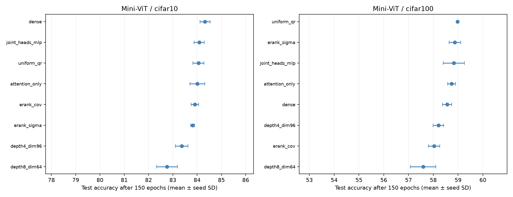

# Результаты расширенного пула

Выполнены **504 обучений**, **21,000 эпох**, **504 test-оценок**, **168 снимков динамики ранга** и **2520 серий измерения скорости** на GPU 0. Публикация не выполнялась.

ResNet-20 и Mini-ViT проверены на CIFAR-10/CIFAR-100, по трём seed. Сопоставлены Uniform, два определения ERank, случайные ширины, L1, Taylor, HRank, Slimming и весовая SVD. Для ViT HRank и gate-slimming являются адаптациями. Все методы и бюджеты приведены в [полном отчёте](report.md).

## ERank и равномерное сужение

Test accuracy при сохранении 75% FLOPs: среднее ± SD между seed. Dense имеет полный бюджет; остальные модели прошли 20 эпох fine-tuning. Абсолютные значения относятся к разбиению v2.

| model | dataset | dense | uniform_qr | erank_sigma | erank_cov |
| --- | --- | --- | --- | --- | --- |
| resnet20 | cifar10 | 91.68 ± 0.17 | 90.99 ± 0.21 | 90.75 ± 0.21 | 90.75 ± 0.13 |
| resnet20 | cifar100 | 66.89 ± 0.11 | 65.27 ± 0.26 | 65.34 ± 0.35 | 65.29 ± 0.32 |
| mini_vit | cifar10 | 84.32 ± 0.21 | 83.96 ± 0.15 | 83.95 ± 0.14 | 83.90 ± 0.08 |
| mini_vit | cifar100 | 58.56 ± 0.18 | 58.24 ± 0.23 | 57.96 ± 0.13 | 57.41 ± 0.09 |

Парная разница ERank − Uniform, в процентных пунктах, с интервалами Бонферрони по всем 24 заранее выбранным сравнениям:

| family | dataset | method | difference_pp | bonferroni24_low | bonferroni24_high | seed_interval_estimable |
| --- | --- | --- | --- | --- | --- | --- |
| mini_vit | cifar10 | erank_sigma | -0.010 | -0.589 | 0.569 | True |
| mini_vit | cifar10 | erank_cov | -0.057 | -2.621 | 2.508 | True |
| mini_vit | cifar100 | erank_sigma | -0.287 | -4.485 | 3.912 | True |
| mini_vit | cifar100 | erank_cov | -0.837 | -4.709 | 3.036 | True |
| resnet20 | cifar10 | erank_sigma | -0.243 | -1.766 | 1.279 | True |
| resnet20 | cifar10 | erank_cov | -0.247 | -2.947 | 2.454 | True |
| resnet20 | cifar100 | erank_sigma | 0.077 | -1.124 | 1.277 | True |
| resnet20 | cifar100 | erank_cov | 0.020 | -5.186 | 5.226 | True |

Во всём наборе из 24 сравнений интервалы целиком выше нуля в **0** случаях, целиком ниже нуля в **0**; неоцениваемых интервалов — **0**. При трёх seed эти оценки предварительные. Интервал, содержащий ноль, не доказывает эквивалентности; результат одного бюджета не переносится на все архитектуры.

## Реальная скорость

Ниже ускорение относительно своей исходной dense-модели при бюджете 75% FLOPs. Значение больше 1 означает ускорение; меньше 1 — замедление. Batch 1 и 128 измерены на GPU отдельно от обучения, в eager/BF16, без загрузки данных и копирования входа с CPU.

| family | dataset | method | speedup_b1 | speedup_b128 |
| --- | --- | --- | --- | --- |
| mini_vit | cifar10 | erank_cov | 0.998 | 0.995 |
| mini_vit | cifar10 | erank_sigma | 0.993 | 0.993 |
| mini_vit | cifar10 | svd | 0.876 | 0.880 |
| mini_vit | cifar10 | uniform_qr | 0.995 | 0.992 |
| mini_vit | cifar100 | erank_cov | 0.997 | 0.993 |
| mini_vit | cifar100 | erank_sigma | 0.994 | 0.991 |
| mini_vit | cifar100 | svd | 0.873 | 0.878 |
| mini_vit | cifar100 | uniform_qr | 0.993 | 0.992 |
| resnet20 | cifar10 | erank_cov | 0.871 | 0.850 |
| resnet20 | cifar10 | erank_sigma | 0.895 | 0.873 |
| resnet20 | cifar10 | svd | 0.899 | 0.868 |
| resnet20 | cifar10 | uniform_qr | 0.920 | 0.902 |
| resnet20 | cifar100 | erank_cov | 0.873 | 0.853 |
| resnet20 | cifar100 | erank_sigma | 0.900 | 0.886 |
| resnet20 | cifar100 | svd | 0.903 | 0.858 |
| resnet20 | cifar100 | uniform_qr | 0.920 | 0.903 |

## Архитектуры Mini-ViT

Описательное сравнение обучения с нуля за 150 эпох: обычная сеть, найденные MLP-ширины, варианты глубины/embedding и удаления attention heads. Бюджеты и размер моделей указаны в таблице; dense имеет полный бюджет, attention-only может отличаться от целевых 75%.

| dataset | phase | method | accuracy_mean | accuracy_sd | flops_mean | params_mean |
| --- | --- | --- | --- | --- | --- | --- |
| cifar10 | architecture_scratch | attention_only | 84.010 | 0.306 | 69797760.000 | 534442.000 |
| cifar10 | architecture_scratch | depth4_dim96 | 83.363 | 0.259 | 71198592.000 | 519779.000 |
| cifar10 | architecture_scratch | depth8_dim64 | 82.763 | 0.430 | 71222528.000 | 503213.000 |
| cifar10 | architecture_scratch | joint_heads_mlp | 84.087 | 0.206 | 71198592.000 | 520931.000 |
| cifar10 | base | dense | 84.323 | 0.208 | 94963584.000 | 683050.000 |
| cifar10 | scratch | erank_cov | 83.910 | 0.151 | 71198592.000 | 496419.000 |
| cifar10 | scratch | erank_sigma | 83.813 | 0.084 | 71198592.000 | 496419.000 |
| cifar10 | scratch | uniform_qr | 84.057 | 0.230 | 71198592.000 | 496419.000 |
| cifar100 | architecture_scratch | attention_only | 58.740 | 0.157 | 69815040.000 | 543172.000 |
| cifar100 | architecture_scratch | depth4_dim96 | 58.207 | 0.217 | 71215872.000 | 528509.000 |
| cifar100 | architecture_scratch | depth8_dim64 | 57.590 | 0.514 | 71234048.000 | 509063.000 |
| cifar100 | architecture_scratch | joint_heads_mlp | 58.823 | 0.429 | 71215872.000 | 529661.000 |
| cifar100 | base | dense | 58.557 | 0.183 | 94980864.000 | 691780.000 |
| cifar100 | scratch | erank_cov | 58.033 | 0.227 | 71215872.000 | 505149.000 |
| cifar100 | scratch | erank_sigma | 58.870 | 0.236 | 71215872.000 | 505149.000 |
| cifar100 | scratch | uniform_qr | 58.977 | 0.029 | 71215872.000 | 505149.000 |

ERank-scratch дополнительно требует обучения исходной сети для поиска ширин. Поэтому одинаковое число эпох обучения небольшой модели не означает одинаковых полных затрат на поиск и обучение.

## Что ограничивает трактовку ранга

Компенсированное масштабирование каналов сохраняет функцию сети с точностью вычислений. Таблица показывает максимальные изменения ранга и logits в предусмотренных вмешательствах:

| family | dataset | interventions | max_sigma_change_pct | max_cov_change_pct | max_logit_difference |
| --- | --- | --- | --- | --- | --- |
| mini_vit | cifar10 | 9 | 44.996137 | 56.550201 | 0.000003 |
| mini_vit | cifar100 | 9 | 48.118873 | 67.079576 | 0.000003 |
| resnet20 | cifar10 | 9 | 47.319346 | 75.429796 | 0.000010 |
| resnet20 | cifar100 | 9 | 47.449367 | 71.598909 | 0.000010 |

Такое изменение ранга ограничивает его трактовку как необходимой ширины функции. Оно не исключает полезности ранга как эвристики в фиксированной процедуре обучения. Проверка этой полезности содержится в равнобюджетных сравнениях выше. Динамика ранга, послойная чувствительность, выбор каналов, sparse-контроли и итерации подробно разобраны в [отчёте](report.md).

Сфера выводов: две небольшие модели, два CIFAR-набора, один split и фиксированные гиперпараметры. Это не проверка больших pretrained ViT и не доказательство универсальной полезности или бесполезности ERank.

- [План и определения](../../experiment_pool_v2.md).
- [Все отдельные результаты](results.csv).
- [Основные сравнения](main_summary.csv).
- [Парные интервалы и различия по seed](primary_comparisons.csv).
- [Код и воспроизведение](../../experiments_v2/README.md).
