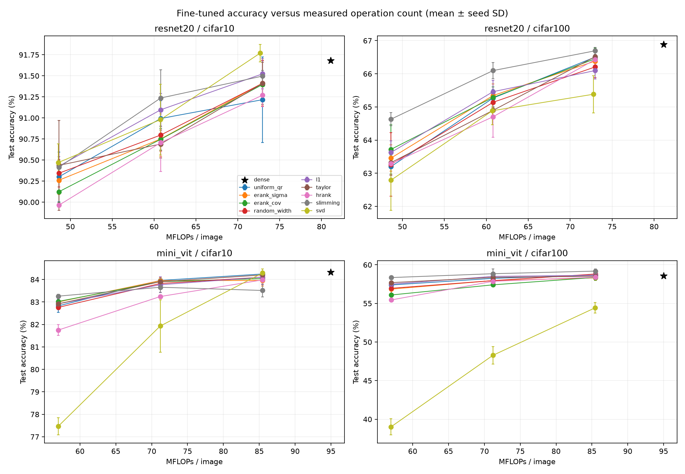
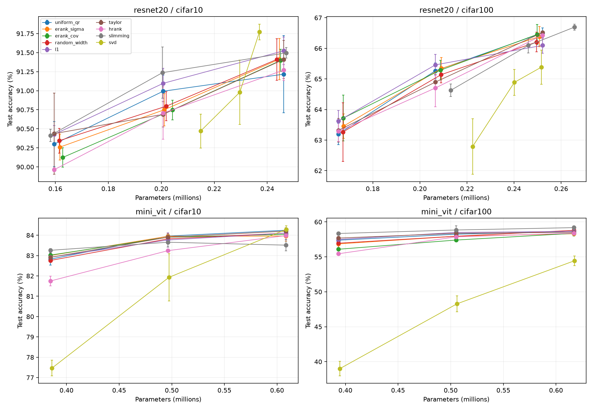
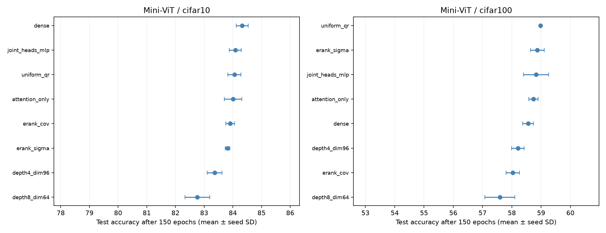
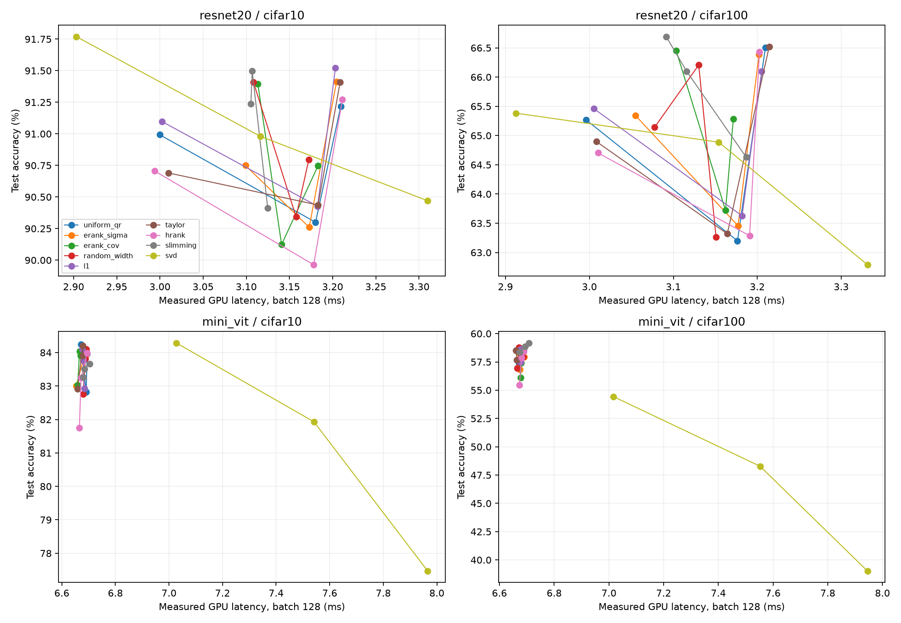
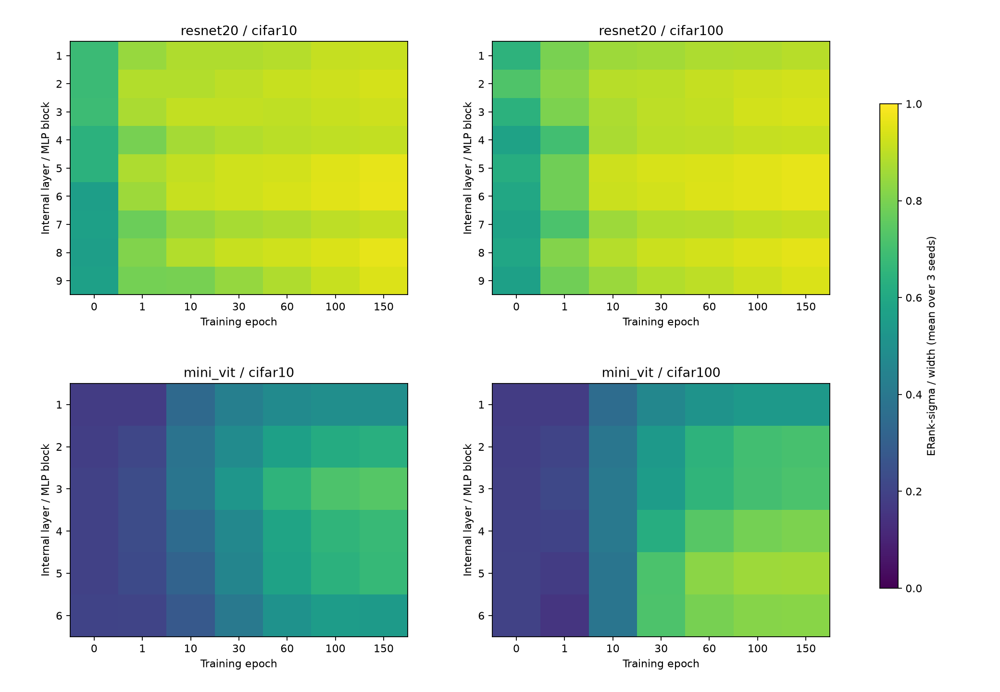

# Расширенный экспериментальный пул ERank

Завершены **504 обучений**, **21,000 эпох** и столько же оценок на официальных test-наборах по 10 000 изображений.

План: [experiment_pool_v2.md](../../experiment_pool_v2.md). Все отдельные результаты: [results.csv](results.csv).

Все обучения и измерения выполнены на GPU 0. Публикация кода не выполнялась. Сумма длительностей отдельных обучений при параллельной работе процессов не равна общему времени выполнения.

## Исходные модели и sparse-контроли

| family | dataset | method | accuracy_mean | accuracy_sd | params | flops |
| --- | --- | --- | --- | --- | --- | --- |
| mini_vit | cifar10 | dense | 84.323 | 0.208 | 683050.000 | 94963584.000 |
| mini_vit | cifar10 | sparse | 83.633 | 0.245 | 685354.000 | 94963584.000 |
| mini_vit | cifar100 | dense | 58.557 | 0.183 | 691780.000 | 94980864.000 |
| mini_vit | cifar100 | sparse | 59.140 | 0.125 | 694084.000 | 94980864.000 |
| resnet20 | cifar10 | dense | 91.680 | 0.173 | 269722.000 | 81102080.000 |
| resnet20 | cifar10 | sparse | 91.930 | 0.173 | 269722.000 | 81102080.000 |
| resnet20 | cifar100 | dense | 66.890 | 0.110 | 275572.000 | 81113600.000 |
| resnet20 | cifar100 | sparse | 67.070 | 0.507 | 275572.000 | 81113600.000 |

Качество исходных моделей на train без аугментаций и на checkpoint-validation:

| family | dataset | model_seed | train_accuracy | validation_accuracy | gap_pp |
| --- | --- | --- | --- | --- | --- |
| resnet20 | cifar10 | 42 | 99.876 | 93.360 | 6.516 |
| resnet20 | cifar10 | 123 | 99.611 | 93.200 | 6.411 |
| resnet20 | cifar10 | 2026 | 99.764 | 93.160 | 6.604 |
| resnet20 | cifar100 | 42 | 90.640 | 66.480 | 24.160 |
| resnet20 | cifar100 | 123 | 90.793 | 66.880 | 23.913 |
| resnet20 | cifar100 | 2026 | 90.416 | 66.560 | 23.856 |
| mini_vit | cifar10 | 42 | 95.204 | 85.160 | 10.044 |
| mini_vit | cifar10 | 123 | 95.822 | 84.920 | 10.902 |
| mini_vit | cifar10 | 2026 | 96.089 | 85.480 | 10.609 |
| mini_vit | cifar100 | 42 | 94.453 | 58.520 | 35.933 |
| mini_vit | cifar100 | 123 | 94.758 | 59.240 | 35.518 |
| mini_vit | cifar100 | 2026 | 95.900 | 58.080 | 37.820 |

Разрыв train/validation учитывается при интерпретации сжатия и сравнения семейств; высокая train accuracy сама по себе не означает хорошего обобщения.

## Основные сравнения

В таблицах mean/SD считаются по трём независимым seed. L1, Taylor и HRank используют ширины Uniform; Slimming использует отдельно обученную sparse-модель. В ViT HRank и gate-slimming являются явно обозначенными адаптациями.

SVD сравнивается по фактическим FLOPs: дискретные ранги допускают небольшое отличие от номинального бюджета. FLOPs учитывают Conv, Linear и оба attention matmul, но не нормализации, GELU/ReLU и softmax.

### mini_vit / cifar10

| budget | method | accuracy_mean | accuracy_sd | params_mean | flops_mean | actual_retained | latency_b1_ms | latency_b128_ms | speedup_b1 | speedup_b128 |
| --- | --- | --- | --- | --- | --- | --- | --- | --- | --- | --- |
| 0.600 | erank_cov | 83.023 | 0.299 | 384672.000 | 56969088.000 | 0.600 | 6.339 | 6.659 | 0.997 | 0.997 |
| 0.600 | erank_sigma | 83.003 | 0.214 | 384672.000 | 56969088.000 | 0.600 | 6.331 | 6.654 | 0.998 | 0.998 |
| 0.600 | hrank | 81.750 | 0.243 | 384672.000 | 56969088.000 | 0.600 | 6.320 | 6.666 | 1.000 | 0.996 |
| 0.600 | l1 | 82.920 | 0.221 | 384672.000 | 56969088.000 | 0.600 | 6.316 | 6.684 | 1.001 | 0.993 |
| 0.600 | random_width | 82.760 | 0.026 | 384672.000 | 56969088.000 | 0.600 | 6.333 | 6.679 | 0.998 | 0.994 |
| 0.600 | slimming | 83.260 | 0.082 | 384672.000 | 56969088.000 | 0.600 | 6.343 | 6.679 | 0.996 | 0.994 |
| 0.600 | svd | 77.467 | 0.382 | 386186.000 | 56964992.000 | 0.600 | 7.653 | 7.966 | 0.826 | 0.834 |
| 0.600 | taylor | 82.917 | 0.247 | 384672.000 | 56969088.000 | 0.600 | 6.315 | 6.659 | 1.001 | 0.997 |
| 0.600 | uniform_qr | 82.827 | 0.287 | 384672.000 | 56969088.000 | 0.600 | 6.334 | 6.691 | 0.998 | 0.992 |
| 0.750 | erank_cov | 83.903 | 0.075 | 496419.000 | 71198592.000 | 0.750 | 6.335 | 6.670 | 0.998 | 0.995 |
| 0.750 | erank_sigma | 83.950 | 0.137 | 496419.000 | 71198592.000 | 0.750 | 6.363 | 6.686 | 0.993 | 0.993 |
| 0.750 | hrank | 83.243 | 0.055 | 496419.000 | 71198592.000 | 0.750 | 6.352 | 6.672 | 0.995 | 0.995 |
| 0.750 | l1 | 83.767 | 0.347 | 496419.000 | 71198592.000 | 0.750 | 6.337 | 6.680 | 0.997 | 0.994 |
| 0.750 | random_width | 83.823 | 0.133 | 496419.000 | 71198592.000 | 0.750 | 6.333 | 6.688 | 0.998 | 0.993 |
| 0.750 | slimming | 83.657 | 0.231 | 496419.000 | 71198592.000 | 0.750 | 6.339 | 6.704 | 0.997 | 0.990 |
| 0.750 | svd | 81.930 | 1.168 | 497322.000 | 71190400.000 | 0.750 | 7.216 | 7.541 | 0.876 | 0.880 |
| 0.750 | taylor | 83.903 | 0.095 | 496419.000 | 71198592.000 | 0.750 | 6.363 | 6.678 | 0.993 | 0.994 |
| 0.750 | uniform_qr | 83.960 | 0.151 | 496419.000 | 71198592.000 | 0.750 | 6.349 | 6.694 | 0.995 | 0.992 |
| 0.900 | erank_cov | 84.043 | 0.170 | 608359.000 | 85452672.000 | 0.900 | 6.345 | 6.666 | 0.996 | 0.996 |
| 0.900 | erank_sigma | 83.960 | 0.254 | 608359.000 | 85452672.000 | 0.900 | 6.327 | 6.692 | 0.999 | 0.992 |
| 0.900 | hrank | 83.983 | 0.208 | 608359.000 | 85452672.000 | 0.900 | 6.348 | 6.695 | 0.996 | 0.992 |
| 0.900 | l1 | 84.107 | 0.085 | 608359.000 | 85452672.000 | 0.900 | 6.349 | 6.677 | 0.995 | 0.994 |
| 0.900 | random_width | 84.107 | 0.117 | 608359.000 | 85452672.000 | 0.900 | 6.345 | 6.690 | 0.996 | 0.992 |
| 0.900 | slimming | 83.513 | 0.283 | 608359.000 | 85452672.000 | 0.900 | 6.342 | 6.684 | 0.996 | 0.993 |
| 0.900 | svd | 84.290 | 0.182 | 608778.000 | 85456768.000 | 0.900 | 6.697 | 7.027 | 0.944 | 0.945 |
| 0.900 | taylor | 84.203 | 0.162 | 608359.000 | 85452672.000 | 0.900 | 6.346 | 6.678 | 0.996 | 0.994 |
| 0.900 | uniform_qr | 84.247 | 0.119 | 608359.000 | 85452672.000 | 0.900 | 6.335 | 6.671 | 0.998 | 0.995 |

### mini_vit / cifar100

| budget | method | accuracy_mean | accuracy_sd | params_mean | flops_mean | actual_retained | latency_b1_ms | latency_b128_ms | speedup_b1 | speedup_b128 |
| --- | --- | --- | --- | --- | --- | --- | --- | --- | --- | --- |
| 0.600 | erank_cov | 56.090 | 0.201 | 393402.000 | 56986368.000 | 0.600 | 6.353 | 6.677 | 0.994 | 0.993 |
| 0.600 | erank_sigma | 56.850 | 0.217 | 393402.000 | 56986368.000 | 0.600 | 6.342 | 6.675 | 0.996 | 0.993 |
| 0.600 | hrank | 55.447 | 0.136 | 393402.000 | 56986368.000 | 0.600 | 6.334 | 6.673 | 0.997 | 0.994 |
| 0.600 | l1 | 57.497 | 0.256 | 393402.000 | 56986368.000 | 0.600 | 6.326 | 6.678 | 0.998 | 0.993 |
| 0.600 | random_width | 56.957 | 0.629 | 393402.000 | 56986368.000 | 0.600 | 6.354 | 6.665 | 0.994 | 0.995 |
| 0.600 | slimming | 58.347 | 0.125 | 393402.000 | 56986368.000 | 0.600 | 6.340 | 6.674 | 0.996 | 0.993 |
| 0.600 | svd | 39.013 | 1.038 | 394820.000 | 56969984.000 | 0.600 | 7.625 | 7.945 | 0.828 | 0.834 |
| 0.600 | taylor | 57.690 | 0.200 | 393402.000 | 56986368.000 | 0.600 | 6.332 | 6.664 | 0.997 | 0.995 |
| 0.600 | uniform_qr | 57.387 | 0.111 | 393402.000 | 56986368.000 | 0.600 | 6.332 | 6.672 | 0.997 | 0.994 |
| 0.750 | erank_cov | 57.407 | 0.085 | 505149.000 | 71215872.000 | 0.750 | 6.334 | 6.679 | 0.997 | 0.993 |
| 0.750 | erank_sigma | 57.957 | 0.133 | 505149.000 | 71215872.000 | 0.750 | 6.352 | 6.690 | 0.994 | 0.991 |
| 0.750 | hrank | 57.863 | 0.110 | 505149.000 | 71215872.000 | 0.750 | 6.367 | 6.680 | 0.992 | 0.992 |
| 0.750 | l1 | 58.500 | 0.135 | 505149.000 | 71215872.000 | 0.750 | 6.371 | 6.689 | 0.991 | 0.991 |
| 0.750 | random_width | 57.953 | 0.032 | 505149.000 | 71215872.000 | 0.750 | 6.331 | 6.686 | 0.998 | 0.992 |
| 0.750 | slimming | 58.847 | 0.605 | 505149.000 | 71215872.000 | 0.750 | 6.340 | 6.694 | 0.996 | 0.990 |
| 0.750 | svd | 48.283 | 1.124 | 505988.000 | 71199488.000 | 0.750 | 7.233 | 7.552 | 0.873 | 0.878 |
| 0.750 | taylor | 58.370 | 0.289 | 505149.000 | 71215872.000 | 0.750 | 6.360 | 6.684 | 0.993 | 0.992 |
| 0.750 | uniform_qr | 58.243 | 0.232 | 505149.000 | 71215872.000 | 0.750 | 6.362 | 6.680 | 0.993 | 0.992 |
| 0.900 | erank_cov | 58.370 | 0.399 | 617089.000 | 85469952.000 | 0.900 | 6.328 | 6.672 | 0.998 | 0.994 |
| 0.900 | erank_sigma | 58.310 | 0.147 | 617089.000 | 85469952.000 | 0.900 | 6.353 | 6.669 | 0.994 | 0.994 |
| 0.900 | hrank | 58.397 | 0.146 | 617089.000 | 85469952.000 | 0.900 | 6.341 | 6.689 | 0.996 | 0.991 |
| 0.900 | l1 | 58.643 | 0.313 | 617089.000 | 85469952.000 | 0.900 | 6.344 | 6.677 | 0.996 | 0.993 |
| 0.900 | random_width | 58.800 | 0.340 | 617089.000 | 85469952.000 | 0.900 | 6.342 | 6.671 | 0.996 | 0.994 |
| 0.900 | slimming | 59.183 | 0.284 | 617089.000 | 85469952.000 | 0.900 | 6.357 | 6.707 | 0.993 | 0.988 |
| 0.900 | svd | 54.437 | 0.696 | 617412.000 | 85461760.000 | 0.900 | 6.684 | 7.016 | 0.945 | 0.945 |
| 0.900 | taylor | 58.520 | 0.436 | 617089.000 | 85469952.000 | 0.900 | 6.350 | 6.660 | 0.995 | 0.995 |
| 0.900 | uniform_qr | 58.663 | 0.350 | 617089.000 | 85469952.000 | 0.900 | 6.339 | 6.675 | 0.996 | 0.993 |

### resnet20 / cifar10

| budget | method | accuracy_mean | accuracy_sd | params_mean | flops_mean | actual_retained | latency_b1_ms | latency_b128_ms | speedup_b1 | speedup_b128 |
| --- | --- | --- | --- | --- | --- | --- | --- | --- | --- | --- |
| 0.600 | erank_cov | 90.123 | 0.127 | 162745.333 | 48624896.000 | 0.600 | 3.034 | 3.141 | 0.873 | 0.861 |
| 0.600 | erank_sigma | 90.260 | 0.171 | 161738.000 | 48624896.000 | 0.600 | 3.057 | 3.173 | 0.866 | 0.853 |
| 0.600 | hrank | 89.963 | 0.025 | 159576.000 | 48624896.000 | 0.600 | 3.063 | 3.178 | 0.865 | 0.851 |
| 0.600 | l1 | 90.427 | 0.115 | 159576.000 | 48624896.000 | 0.600 | 3.064 | 3.183 | 0.864 | 0.850 |
| 0.600 | random_width | 90.343 | 0.163 | 161450.000 | 48624896.000 | 0.600 | 3.037 | 3.158 | 0.873 | 0.857 |
| 0.600 | slimming | 90.413 | 0.081 | 158132.667 | 48624896.000 | 0.600 | 3.017 | 3.125 | 0.878 | 0.866 |
| 0.600 | svd | 90.470 | 0.223 | 214842.000 | 48547072.000 | 0.599 | 3.071 | 3.310 | 0.862 | 0.817 |
| 0.600 | taylor | 90.437 | 0.533 | 159576.000 | 48624896.000 | 0.600 | 3.071 | 3.183 | 0.863 | 0.850 |
| 0.600 | uniform_qr | 90.300 | 0.294 | 159576.000 | 48624896.000 | 0.600 | 3.072 | 3.180 | 0.862 | 0.851 |
| 0.750 | erank_cov | 90.747 | 0.129 | 204176.000 | 60790016.000 | 0.750 | 3.042 | 3.183 | 0.871 | 0.850 |
| 0.750 | erank_sigma | 90.750 | 0.212 | 201149.333 | 60790016.000 | 0.750 | 2.961 | 3.099 | 0.895 | 0.873 |
| 0.750 | hrank | 90.707 | 0.343 | 200718.000 | 60790016.000 | 0.750 | 2.887 | 2.994 | 0.918 | 0.904 |
| 0.750 | l1 | 91.097 | 0.195 | 200718.000 | 60790016.000 | 0.750 | 2.883 | 3.003 | 0.919 | 0.901 |
| 0.750 | random_width | 90.797 | 0.190 | 201869.333 | 60790016.000 | 0.750 | 3.067 | 3.172 | 0.864 | 0.853 |
| 0.750 | slimming | 91.237 | 0.336 | 200431.333 | 60790016.000 | 0.750 | 3.010 | 3.105 | 0.881 | 0.872 |
| 0.750 | svd | 90.980 | 0.422 | 229647.333 | 60764074.667 | 0.749 | 2.946 | 3.116 | 0.899 | 0.868 |
| 0.750 | taylor | 90.690 | 0.165 | 200718.000 | 60790016.000 | 0.750 | 2.885 | 3.010 | 0.918 | 0.899 |
| 0.750 | uniform_qr | 90.993 | 0.212 | 200718.000 | 60790016.000 | 0.750 | 2.878 | 3.000 | 0.920 | 0.902 |
| 0.900 | erank_cov | 91.397 | 0.146 | 245029.333 | 72955136.000 | 0.900 | 2.983 | 3.113 | 0.888 | 0.869 |
| 0.900 | erank_sigma | 91.413 | 0.271 | 244600.667 | 72955136.000 | 0.900 | 3.094 | 3.205 | 0.856 | 0.844 |
| 0.900 | hrank | 91.270 | 0.137 | 246188.000 | 72955136.000 | 0.900 | 3.101 | 3.211 | 0.854 | 0.842 |
| 0.900 | l1 | 91.523 | 0.180 | 246188.000 | 72955136.000 | 0.900 | 3.089 | 3.203 | 0.857 | 0.845 |
| 0.900 | random_width | 91.410 | 0.272 | 243592.667 | 72955136.000 | 0.900 | 3.010 | 3.108 | 0.880 | 0.871 |
| 0.900 | slimming | 91.497 | 0.068 | 247200.667 | 72955136.000 | 0.900 | 3.011 | 3.107 | 0.880 | 0.871 |
| 0.900 | svd | 91.770 | 0.104 | 237050.000 | 72680704.000 | 0.896 | 2.801 | 2.903 | 0.946 | 0.932 |
| 0.900 | taylor | 91.410 | 0.250 | 246188.000 | 72955136.000 | 0.900 | 3.096 | 3.209 | 0.856 | 0.843 |
| 0.900 | uniform_qr | 91.217 | 0.508 | 246188.000 | 72955136.000 | 0.900 | 3.096 | 3.209 | 0.856 | 0.843 |

### resnet20 / cifar100

| budget | method | accuracy_mean | accuracy_sd | params_mean | flops_mean | actual_retained | latency_b1_ms | latency_b128_ms | speedup_b1 | speedup_b128 |
| --- | --- | --- | --- | --- | --- | --- | --- | --- | --- | --- |
| 0.600 | erank_cov | 63.720 | 0.747 | 167442.667 | 48636416.000 | 0.600 | 3.056 | 3.162 | 0.868 | 0.856 |
| 0.600 | erank_sigma | 63.457 | 0.397 | 167588.000 | 48636416.000 | 0.600 | 3.070 | 3.177 | 0.864 | 0.852 |
| 0.600 | hrank | 63.287 | 0.333 | 165426.000 | 48636416.000 | 0.600 | 3.072 | 3.191 | 0.863 | 0.848 |
| 0.600 | l1 | 63.627 | 0.344 | 165426.000 | 48636416.000 | 0.600 | 3.068 | 3.182 | 0.864 | 0.851 |
| 0.600 | random_width | 63.263 | 0.958 | 167300.000 | 48636416.000 | 0.600 | 3.024 | 3.151 | 0.877 | 0.859 |
| 0.600 | slimming | 64.630 | 0.201 | 213156.000 | 48636416.000 | 0.600 | 3.074 | 3.187 | 0.863 | 0.849 |
| 0.600 | svd | 62.790 | 0.907 | 222388.000 | 48640512.000 | 0.600 | 3.080 | 3.331 | 0.861 | 0.812 |
| 0.600 | taylor | 63.320 | 0.387 | 165426.000 | 48636416.000 | 0.600 | 3.051 | 3.164 | 0.869 | 0.855 |
| 0.600 | uniform_qr | 63.200 | 0.352 | 165426.000 | 48636416.000 | 0.600 | 3.061 | 3.176 | 0.866 | 0.852 |
| 0.750 | erank_cov | 65.287 | 0.321 | 208729.333 | 60801536.000 | 0.750 | 3.038 | 3.171 | 0.873 | 0.853 |
| 0.750 | erank_sigma | 65.343 | 0.355 | 209164.000 | 60801536.000 | 0.750 | 2.946 | 3.055 | 0.900 | 0.886 |
| 0.750 | hrank | 64.703 | 0.613 | 206568.000 | 60801536.000 | 0.750 | 2.899 | 3.010 | 0.915 | 0.899 |
| 0.750 | l1 | 65.460 | 0.340 | 206568.000 | 60801536.000 | 0.750 | 2.895 | 3.005 | 0.916 | 0.901 |
| 0.750 | random_width | 65.140 | 0.265 | 209020.000 | 60801536.000 | 0.750 | 2.959 | 3.078 | 0.896 | 0.879 |
| 0.750 | slimming | 66.097 | 0.245 | 246081.333 | 60801536.000 | 0.750 | 3.013 | 3.116 | 0.880 | 0.869 |
| 0.750 | svd | 64.887 | 0.425 | 240116.000 | 60731904.000 | 0.749 | 2.934 | 3.154 | 0.903 | 0.858 |
| 0.750 | taylor | 64.897 | 0.250 | 206568.000 | 60801536.000 | 0.750 | 2.899 | 3.008 | 0.915 | 0.900 |
| 0.750 | uniform_qr | 65.267 | 0.261 | 206568.000 | 60801536.000 | 0.750 | 2.882 | 2.996 | 0.920 | 0.903 |
| 0.900 | erank_cov | 66.453 | 0.323 | 249727.333 | 72966656.000 | 0.900 | 2.992 | 3.103 | 0.886 | 0.872 |
| 0.900 | erank_sigma | 66.383 | 0.329 | 250738.667 | 72966656.000 | 0.900 | 3.090 | 3.202 | 0.858 | 0.845 |
| 0.900 | hrank | 66.430 | 0.114 | 252038.000 | 72966656.000 | 0.900 | 3.091 | 3.203 | 0.858 | 0.845 |
| 0.900 | l1 | 66.097 | 0.256 | 252038.000 | 72966656.000 | 0.900 | 3.097 | 3.205 | 0.856 | 0.844 |
| 0.900 | random_width | 66.207 | 0.319 | 249586.667 | 72966656.000 | 0.900 | 3.027 | 3.130 | 0.876 | 0.865 |
| 0.900 | slimming | 66.693 | 0.101 | 265594.667 | 72966656.000 | 0.900 | 2.981 | 3.091 | 0.890 | 0.876 |
| 0.900 | svd | 65.383 | 0.560 | 251540.000 | 72774144.000 | 0.897 | 2.802 | 2.913 | 0.946 | 0.929 |
| 0.900 | taylor | 66.517 | 0.050 | 252038.000 | 72966656.000 | 0.900 | 3.102 | 3.214 | 0.855 | 0.842 |
| 0.900 | uniform_qr | 66.503 | 0.163 | 252038.000 | 72966656.000 | 0.900 | 3.097 | 3.210 | 0.856 | 0.843 |

## Парные проверки ERank против Uniform

24 первичных сравнения анализируются совместно. Приведены t-интервалы между seed с поправкой Бонферрони; при n=3 их надёжность ограничена. Дополнительные conditional_image интервалы получены парным bootstrap изображений с сохранением числа примеров каждого класса; они условны на уже обученных моделях и не заменяют вариативность обучения. Отсутствие значимости не означает эквивалентности.

При одинаковых парных различиях по всем seed t-интервал не оценивается (поле seed_interval_estimable=False); наблюдаемый нулевой разброс не считается доказательством точного эффекта или эквивалентности.

| family | dataset | budget | method | difference_pp | n | seed_interval_estimable | bonferroni24_low | bonferroni24_high | conditional_image_ci95_low | conditional_image_ci95_high |
| --- | --- | --- | --- | --- | --- | --- | --- | --- | --- | --- |
| mini_vit | cifar10 | 0.600 | erank_sigma | 0.177 | 3 | True | -3.947 | 4.301 | -0.060 | 0.403 |
| mini_vit | cifar10 | 0.600 | erank_cov | 0.197 | 3 | True | -3.762 | 4.155 | -0.077 | 0.453 |
| mini_vit | cifar10 | 0.750 | erank_sigma | -0.010 | 3 | True | -0.589 | 0.569 | -0.187 | 0.167 |
| mini_vit | cifar10 | 0.750 | erank_cov | -0.057 | 3 | True | -2.621 | 2.508 | -0.267 | 0.160 |
| mini_vit | cifar10 | 0.900 | erank_sigma | -0.287 | 3 | True | -2.671 | 2.097 | -0.500 | -0.083 |
| mini_vit | cifar10 | 0.900 | erank_cov | -0.203 | 3 | True | -1.117 | 0.710 | -0.407 | -0.003 |
| mini_vit | cifar100 | 0.600 | erank_sigma | -0.537 | 3 | True | -3.954 | 2.881 | -0.843 | -0.217 |
| mini_vit | cifar100 | 0.600 | erank_cov | -1.297 | 3 | True | -4.216 | 1.623 | -1.683 | -0.903 |
| mini_vit | cifar100 | 0.750 | erank_sigma | -0.287 | 3 | True | -4.485 | 3.912 | -0.617 | 0.017 |
| mini_vit | cifar100 | 0.750 | erank_cov | -0.837 | 3 | True | -4.709 | 3.036 | -1.207 | -0.470 |
| mini_vit | cifar100 | 0.900 | erank_sigma | -0.353 | 3 | True | -3.913 | 3.206 | -0.680 | -0.043 |
| mini_vit | cifar100 | 0.900 | erank_cov | -0.293 | 3 | True | -3.349 | 2.762 | -0.617 | 0.017 |
| resnet20 | cifar10 | 0.600 | erank_sigma | -0.040 | 3 | True | -4.146 | 4.066 | -0.267 | 0.193 |
| resnet20 | cifar10 | 0.600 | erank_cov | -0.177 | 3 | True | -5.237 | 4.883 | -0.447 | 0.070 |
| resnet20 | cifar10 | 0.750 | erank_sigma | -0.243 | 3 | True | -1.766 | 1.279 | -0.467 | -0.020 |
| resnet20 | cifar10 | 0.750 | erank_cov | -0.247 | 3 | True | -2.947 | 2.454 | -0.480 | -0.010 |
| resnet20 | cifar10 | 0.900 | erank_sigma | 0.197 | 3 | True | -3.503 | 3.897 | -0.007 | 0.383 |
| resnet20 | cifar10 | 0.900 | erank_cov | 0.180 | 3 | True | -5.509 | 5.869 | -0.040 | 0.403 |
| resnet20 | cifar100 | 0.600 | erank_sigma | 0.257 | 3 | True | -1.425 | 1.938 | -0.077 | 0.587 |
| resnet20 | cifar100 | 0.600 | erank_cov | 0.520 | 3 | True | -4.612 | 5.652 | 0.153 | 0.870 |
| resnet20 | cifar100 | 0.750 | erank_sigma | 0.077 | 3 | True | -1.124 | 1.277 | -0.203 | 0.363 |
| resnet20 | cifar100 | 0.750 | erank_cov | 0.020 | 3 | True | -5.186 | 5.226 | -0.320 | 0.360 |
| resnet20 | cifar100 | 0.900 | erank_sigma | -0.120 | 3 | True | -4.626 | 4.386 | -0.390 | 0.170 |
| resnet20 | cifar100 | 0.900 | erank_cov | -0.050 | 3 | True | -2.782 | 2.682 | -0.397 | 0.293 |

Число первичных интервалов, не содержащих ноль: **0 из 24**. Знак и размер каждого эффекта указаны в таблице; вывод не переносится на другие семейства и данные.

## Отбор каналов, обучение с нуля и итерации

| family | dataset | phase | method | accuracy_mean | accuracy_sd | actual_retained | params_mean | speedup_b1 | speedup_b128 |
| --- | --- | --- | --- | --- | --- | --- | --- | --- | --- |
| mini_vit | cifar10 | architecture_ft | attention_only | 82.423 | 0.454 | 0.735 | 534442.000 | 1.022 | 1.065 |
| mini_vit | cifar10 | architecture_ft | joint_heads_mlp | 83.773 | 0.055 | 0.750 | 520931.000 | 0.990 | 0.990 |
| mini_vit | cifar10 | architecture_scratch | attention_only | 84.010 | 0.306 | 0.735 | 534442.000 | 1.024 | 1.065 |
| mini_vit | cifar10 | architecture_scratch | depth4_dim96 | 83.363 | 0.259 | 0.750 | 519779.000 | 1.457 | 1.444 |
| mini_vit | cifar10 | architecture_scratch | depth8_dim64 | 82.763 | 0.430 | 0.750 | 503213.000 | 0.758 | 0.754 |
| mini_vit | cifar10 | architecture_scratch | joint_heads_mlp | 84.087 | 0.206 | 0.750 | 520931.000 | 0.995 | 0.997 |
| mini_vit | cifar10 | control | dense_ft | 84.290 | 0.155 | 1.000 | 683050.000 | 1.003 | 1.000 |
| mini_vit | cifar10 | control | sparse_uniform_ft | 83.520 | 0.246 | 0.750 | 496419.000 | 0.997 | 0.996 |
| mini_vit | cifar10 | iterative | erank_ceil_r1 | 84.007 | 0.188 | 0.781 | 520093.667 | 0.989 | 0.988 |
| mini_vit | cifar10 | iterative | erank_ceil_r2 | 83.820 | 0.089 | 0.692 | 453444.333 | 0.997 | 0.993 |
| mini_vit | cifar10 | iterative | erank_ceil_r3 | 83.577 | 0.127 | 0.634 | 410405.333 | 0.994 | 0.992 |
| mini_vit | cifar10 | scratch | erank_cov | 83.910 | 0.151 | 0.750 | 496419.000 | 0.998 | 0.996 |
| mini_vit | cifar10 | scratch | erank_sigma | 83.813 | 0.084 | 0.750 | 496419.000 | 0.998 | 0.995 |
| mini_vit | cifar10 | scratch | uniform_qr | 84.057 | 0.230 | 0.750 | 496419.000 | 0.994 | 0.988 |
| mini_vit | cifar10 | selection_ablation | erank_l1 | 83.940 | 0.165 | 0.750 | 496419.000 | 0.999 | 0.994 |
| mini_vit | cifar10 | selection_ablation | erank_taylor | 83.757 | 0.191 | 0.750 | 496419.000 | 0.998 | 0.996 |
| mini_vit | cifar100 | architecture_ft | attention_only | 55.843 | 0.752 | 0.735 | 543172.000 | 1.019 | 1.064 |
| mini_vit | cifar100 | architecture_ft | joint_heads_mlp | 57.473 | 0.332 | 0.750 | 529661.000 | 0.995 | 0.991 |
| mini_vit | cifar100 | architecture_scratch | attention_only | 58.740 | 0.157 | 0.735 | 543172.000 | 1.022 | 1.065 |
| mini_vit | cifar100 | architecture_scratch | depth4_dim96 | 58.207 | 0.217 | 0.750 | 528509.000 | 1.456 | 1.442 |
| mini_vit | cifar100 | architecture_scratch | depth8_dim64 | 57.590 | 0.514 | 0.750 | 509063.000 | 0.758 | 0.754 |
| mini_vit | cifar100 | architecture_scratch | joint_heads_mlp | 58.823 | 0.429 | 0.750 | 529661.000 | 0.994 | 0.988 |
| mini_vit | cifar100 | control | dense_ft | 58.760 | 0.178 | 1.000 | 691780.000 | 1.000 | 1.000 |
| mini_vit | cifar100 | control | sparse_uniform_ft | 58.887 | 0.462 | 0.750 | 505149.000 | 0.990 | 0.991 |
| mini_vit | cifar100 | iterative | erank_ceil_r1 | 58.263 | 0.351 | 0.857 | 584922.333 | 0.995 | 0.992 |
| mini_vit | cifar100 | iterative | erank_ceil_r2 | 57.970 | 0.072 | 0.787 | 532619.333 | 0.995 | 0.992 |
| mini_vit | cifar100 | iterative | erank_ceil_r3 | 57.473 | 0.264 | 0.734 | 493569.000 | 0.992 | 0.990 |
| mini_vit | cifar100 | scratch | erank_cov | 58.033 | 0.227 | 0.750 | 505149.000 | 0.996 | 0.991 |
| mini_vit | cifar100 | scratch | erank_sigma | 58.870 | 0.236 | 0.750 | 505149.000 | 0.994 | 0.993 |
| mini_vit | cifar100 | scratch | uniform_qr | 58.977 | 0.029 | 0.750 | 505149.000 | 0.993 | 0.991 |
| mini_vit | cifar100 | selection_ablation | erank_l1 | 58.300 | 0.171 | 0.750 | 505149.000 | 0.996 | 0.993 |
| mini_vit | cifar100 | selection_ablation | erank_taylor | 58.227 | 0.292 | 0.750 | 505149.000 | 0.995 | 0.994 |
| resnet20 | cifar10 | control | dense_ft | 91.763 | 0.101 | 1.000 | 269722.000 | 0.997 | 0.998 |
| resnet20 | cifar10 | control | sparse_uniform_ft | 91.187 | 0.175 | 0.750 | 200718.000 | 0.920 | 0.902 |
| resnet20 | cifar10 | iterative | erank_ceil_r1 | 91.610 | 0.214 | 0.951 | 256680.000 | 0.857 | 0.848 |
| resnet20 | cifar10 | iterative | erank_ceil_r2 | 91.530 | 0.140 | 0.921 | 246190.667 | 0.857 | 0.848 |
| resnet20 | cifar10 | iterative | erank_ceil_r3 | 91.380 | 0.092 | 0.898 | 237145.333 | 0.864 | 0.850 |
| resnet20 | cifar10 | scratch | erank_cov | 90.997 | 0.203 | 0.750 | 204176.000 | 0.869 | 0.850 |
| resnet20 | cifar10 | scratch | erank_sigma | 90.780 | 0.174 | 0.750 | 201149.333 | 0.892 | 0.871 |
| resnet20 | cifar10 | scratch | uniform_qr | 90.980 | 0.357 | 0.750 | 200718.000 | 0.920 | 0.903 |
| resnet20 | cifar10 | selection_ablation | erank_l1 | 90.940 | 0.155 | 0.750 | 201149.333 | 0.894 | 0.874 |
| resnet20 | cifar10 | selection_ablation | erank_taylor | 90.820 | 0.096 | 0.750 | 201149.333 | 0.892 | 0.872 |
| resnet20 | cifar100 | control | dense_ft | 66.890 | 0.110 | 1.000 | 275572.000 | 0.999 | 0.999 |
| resnet20 | cifar100 | control | sparse_uniform_ft | 65.017 | 0.251 | 0.750 | 206568.000 | 0.917 | 0.901 |
| resnet20 | cifar100 | iterative | erank_ceil_r1 | 66.740 | 0.211 | 0.954 | 262771.333 | 0.865 | 0.857 |
| resnet20 | cifar100 | iterative | erank_ceil_r2 | 66.330 | 0.087 | 0.919 | 251800.000 | 0.864 | 0.854 |
| resnet20 | cifar100 | iterative | erank_ceil_r3 | 66.477 | 0.166 | 0.895 | 242370.000 | 0.865 | 0.854 |
| resnet20 | cifar100 | scratch | erank_cov | 65.397 | 0.494 | 0.750 | 208729.333 | 0.874 | 0.853 |
| resnet20 | cifar100 | scratch | erank_sigma | 64.987 | 0.424 | 0.750 | 209164.000 | 0.899 | 0.886 |
| resnet20 | cifar100 | scratch | uniform_qr | 65.393 | 0.520 | 0.750 | 206568.000 | 0.918 | 0.904 |
| resnet20 | cifar100 | selection_ablation | erank_l1 | 65.113 | 0.522 | 0.750 | 209164.000 | 0.899 | 0.886 |
| resnet20 | cifar100 | selection_ablation | erank_taylor | 64.893 | 0.287 | 0.750 | 209164.000 | 0.895 | 0.882 |

После определения архитектуры scratch использует 150 эпох небольшой модели, fine-tuning — 20. Если учитывать всю процедуру, ERank-scratch также требует предварительных 150 эпох исходной сети для поиска ширин: 150 dense + 150 small против 150 dense + 20 small у ERank fine-tuning. Uniform-scratch не требует такого поиска. Стоимость исходной сети может амортизироваться между несколькими бюджетами; равенство полного compute не заявляется. Sparse-методы используют собственные 150 эпох подготовки.

Три итерации прямого ceil(ERank) не гарантируют сходимости: фактические ширины и бюджеты каждого раунда сохранены в results.csv и diagnostics/*/iterative_trajectory.json.

Изменение глубины/embedding ViT проверяется с подобранной под общий бюджет шириной MLP. Attention-only использует целые heads и может отличаться от номинальных 75% FLOPs; его нельзя объявлять точным равнобюджетным сравнением.

На следующем графике все показанные модели обучены с нуля 150 эпох. Dense имеет исходный бюджет; для остальных точные FLOPs и параметры сохранены в [vit_architecture_summary.csv](vit_architecture_summary.csv). Стоимость поиска архитектур ERank в эти 150 эпох не включена.

## Скорость инференса

Измерены batch 1 и 128: вход на GPU, eager/BF16, deterministic cuDNN без benchmark, 30 warmup и 100 повторов в каждой из пяти перемешанных серий. Сохранены CUDA event latency и синхронизированное wall-clock время серии. Обучающие процессы к этому моменту завершены; серии с посторонними процессами на GPU 0 не принимаются. Скорость не включает загрузку данных, CPU preprocessing или копирование CPU→GPU.

Значение speedup > 1 означает ускорение, < 1 — замедление. Снижение FLOPs само по себе ускорения не гарантирует. Медианы, IQR, разброс медиан серий и исходные CUDA event timings сохранены.

## Динамика ранга

Ранги измерены на фиксированных 256 calibration-изображениях на эпохах 0, 1, 10, 30, 60, 100, 150. Тепловые карты усредняют три seed исходных dense-моделей. Полные dense и sparse данные: [rank_dynamics.csv](rank_dynamics.csv).

## Проверка интерпретации ранга

В каждом блоке отдельно удаляются 25% или 50% внутренних каналов по QR без дообучения; для CNN пересчитывается BN. Ниже описательные корреляции между нормированным рангом блока и ростом validation loss относительно исходной модели с тем же пересчётом BN. Среднее и SD относятся к трём seed; одна корреляция использует 9 блоков ResNet или 6 блоков ViT.

| family | dataset | fraction | method | spearman_mean | spearman_sd | seeds |
| --- | --- | --- | --- | --- | --- | --- |
| mini_vit | cifar10 | 0.250 | cov | -0.352 | 0.238 | 3 |
| mini_vit | cifar10 | 0.250 | sigma | -0.333 | 0.293 | 3 |
| mini_vit | cifar10 | 0.500 | cov | -0.200 | 0.171 | 3 |
| mini_vit | cifar10 | 0.500 | sigma | -0.238 | 0.087 | 3 |
| mini_vit | cifar100 | 0.250 | cov | 0.429 | 0.000 | 3 |
| mini_vit | cifar100 | 0.250 | sigma | 0.505 | 0.066 | 3 |
| mini_vit | cifar100 | 0.500 | cov | -0.390 | 0.087 | 3 |
| mini_vit | cifar100 | 0.500 | sigma | -0.276 | 0.033 | 3 |
| resnet20 | cifar10 | 0.250 | cov | 0.100 | 0.176 | 3 |
| resnet20 | cifar10 | 0.250 | sigma | 0.206 | 0.170 | 3 |
| resnet20 | cifar10 | 0.500 | cov | -0.072 | 0.169 | 3 |
| resnet20 | cifar10 | 0.500 | sigma | 0.011 | 0.079 | 3 |
| resnet20 | cifar100 | 0.250 | cov | -0.117 | 0.076 | 3 |
| resnet20 | cifar100 | 0.250 | sigma | 0.139 | 0.038 | 3 |
| resnet20 | cifar100 | 0.500 | cov | -0.083 | 0.180 | 3 |
| resnet20 | cifar100 | 0.500 | sigma | 0.150 | 0.130 | 3 |

Эта корреляция не изолирует причинную роль ранга: блоки также различаются положением, шириной и функцией. Она проверяет ограниченную предсказательную связь при данном вмешательстве. Мгновенная чувствительность не заменяет качество после fine-tuning.

В трёх выбранных блоках каждой исходной сети выполняется компенсированное масштабирование каналов: следующий линейный оператор получает обратный множитель. Проверяется сохранение logits на 128 calibration-изображениях. Ниже максимальные относительные изменения ранга и максимальное абсолютное изменение logits по этим вмешательствам; это описательная диагностика, не независимые повторные обучения.

| family | dataset | interventions | max_sigma_change_pct | max_cov_change_pct | max_logit_difference |
| --- | --- | --- | --- | --- | --- |
| mini_vit | cifar10 | 9 | 44.996137 | 56.550201 | 0.000003 |
| mini_vit | cifar100 | 9 | 48.118873 | 67.079576 | 0.000003 |
| resnet20 | cifar10 | 9 | 47.319346 | 75.429796 | 0.000010 |
| resnet20 | cifar100 | 9 | 47.449367 | 71.598909 | 0.000010 |

Зависимость ранга от такого представления параметров ограничивает его интерпретацию как необходимой ширины функции сети. Энтропийный ранг не задаёт гарантированную ошибку усечения и не указывает, какие координатные каналы следует оставить. Весовая SVD в этом пуле также не является проверкой PCA/SVD-проекции самих активаций.

## Ограничения

- Три seed дают предварительную статистику. Изображения, слои, эпохи и повторы тайминга не подменяют независимые обучения.
- Использованы один фиксированный split, одна общая калибровочная подвыборка и один набор гиперпараметров на семейство. Неопределённость по другим разбиениям и настройкам не измерена.
- Результаты относятся к двум небольшим моделям и двум CIFAR-наборам; это не проверка больших pretrained ViT или языковых моделей.
- CNN и ViT обучались с различными подходящими оптимизаторами и регуляризацией; сравнение между ними не изолирует только архитектуру.
- HRank на ViT использует patch-grid карты, gate-slimming — обучаемые множители MLP. Это адаптации, а не неизменённые оригинальные алгоритмы.
- CIFAR-10 test уже анализировался в v1. V2-план фиксировался перед новой оценкой; CIFAR-100 является дополнительной проверкой.
- Источники методов, определения бюджетов и все режимы обучения зафиксированы в плане.

## Артефакты

- `models/`: best/last checkpoints, архитектуры, выбранные каналы, эпохи, test и предсказания.
- `latency/`: все отдельные времена, порядок серий и состояние GPU.
- `rank_dynamics.csv`, `sensitivity.csv`, `rescaling.csv`: динамика и диагностические вмешательства.
- `planned_runs.csv`, `config.json`, `splits/`, `frozen_test_manifest.json`: протокол и воспроизводимость.
