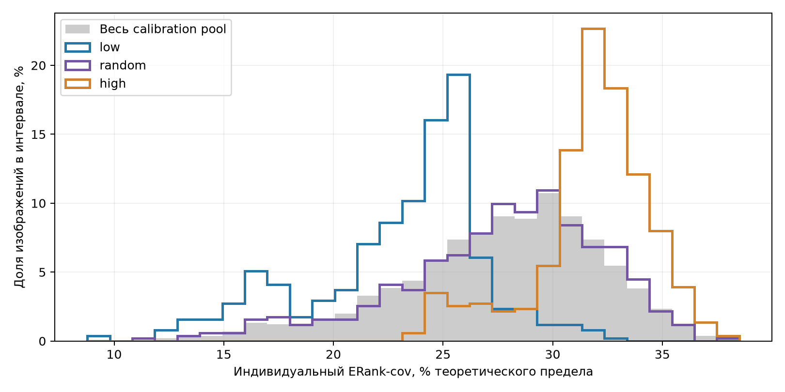
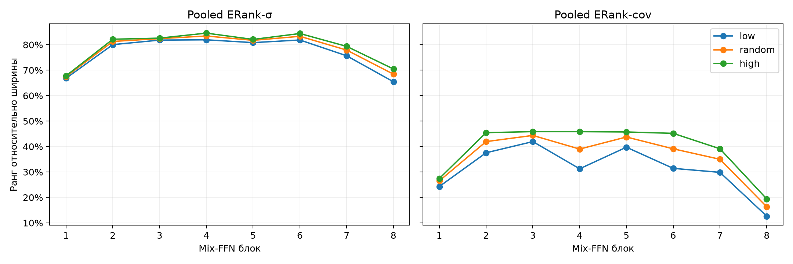

# Что изменяет выбор изображений низкого ранга

512 изображений в каждой группе; одинаковые квоты по доминирующему классу. Индивидуальный ранг нормирован на предел выборочного спектра, pooled-ранг — на ширину канала. Это разные величины. Таблица не содержит результатов сжатия по mIoU.

| Группа | Индивидуальный ERank-cov, % предела | Pooled ERank-σ, % ширины | Pooled ERank-cov, % ширины |
| --- | ---: | ---: | ---: |
| low | 22,96 | 76,81 | 31,09 |
| random | 27,67 | 78,25 | 35,75 |
| high | 31,79 | 79,18 | 39,25 |

Контроль на 32 калибровочных изображениях: Spearman между выбранными 256 позициями и полным пространственным спектром — 0.973. Это ограниченная проверка, не гарантия точности для всех изображений.

Low-отбор сам по себе не доказывает возможность большего сжатия без потери качества. Это проверяют основные парные эксперименты.
