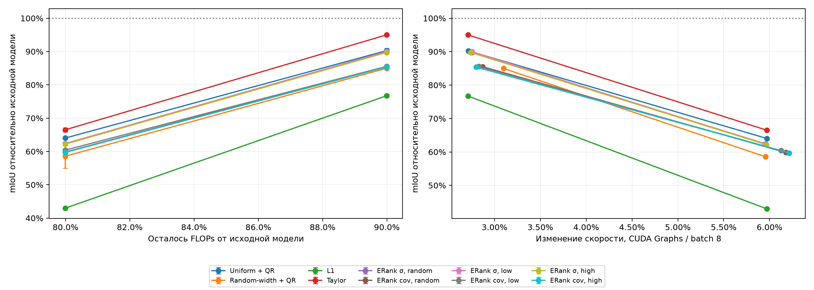
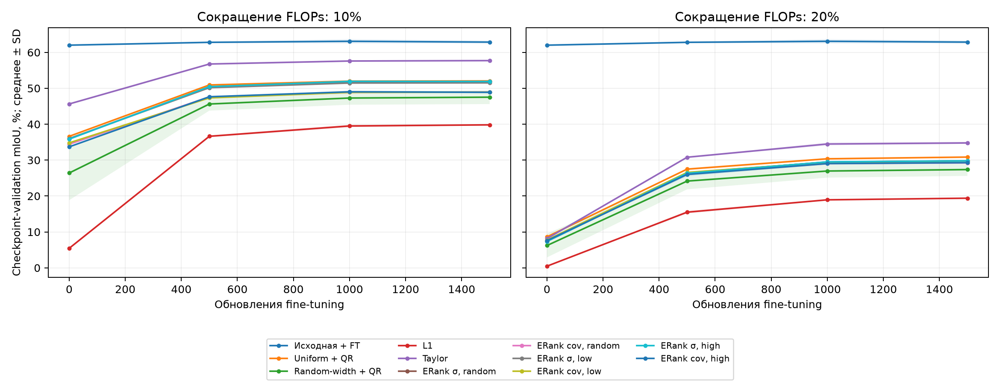

# ERank на ADE20K: результаты сегментации

SegFormer-B1, 512×512, 150 классов; один опубликованный исходный checkpoint, три seed fine-tuning. Исходный mIoU на официальных 2000 validation-изображениях: **40,94%**.

Завершены 63 fine-tuning по 1500 обновлений. Это примерно **0.68 эпохи** на выделенном train для каждого кандидата. У 51 из 63 кандидатов лучшим оказался последний проверенный шаг: фиксированный бюджет не является доказательством сходимости.

## Единицы и условия

- Качество = 100 × mIoU / mIoU исходной модели. Разница в относительных процентах не равна разнице mIoU в процентных пунктах.
- Параметры и FLOPs — доля от исходной модели. Все методы внутри бюджета имеют одинаковые реальные MACs и ширины, кратные 8.
- Скорость = 100 × (время исходной / время кандидата − 1), плюс означает ускорение. Dense и кандидат сравниваются в одном режиме и batch.
- Время включает GPU forward, bilinear resize до 512×512 и argmax. CPU preprocessing, передача входа и создание CUDA Graph исключены. Графы имеют фиксированный размер входа.
- В строках качество ± SD трёх seed fine-tuning. Это условная вариативность при одном исходном обучении и одной калибровке.

## Несжатый контроль

| Метод | mIoU, % | Сохранено качества, % | Параметры, % | FLOPs, % |
| --- | ---: | ---: | ---: | ---: |
| Исходная + FT | 41,41 | 101,15 ± 0,20 | 100,0 | 100,00 |
| Исходная | 40,94 | 100,00 ± — | 100,0 | 100,00 |

| Метод | Eager, batch 1 | Graph, batch 1 | Eager, batch 8 | Graph, batch 8 |
| --- | ---: | ---: | ---: | ---: |
| Исходная + FT | +0,0% | -0,0% | -0,0% | -0,0% |
| Исходная | +0,0% | +0,0% | +0,0% | +0,0% |

## Сокращение общих FLOPs примерно на 10%

| Метод | mIoU, % | Сохранено качества, % | Параметры, % | FLOPs, % |
| --- | ---: | ---: | ---: | ---: |
| Uniform + QR | 36,96 | 90,26 ± 0,69 | 85,6 | 89,99 |
| Random-width + QR | 34,80 | 84,98 ± 0,37 | 85,0 | 89,99 |
| L1 | 31,42 | 76,73 ± 0,22 | 85,6 | 89,99 |
| Taylor | 38,90 | 95,01 ± 0,27 | 85,6 | 89,99 |
| ERank σ, random | 36,75 | 89,75 ± 0,13 | 84,9 | 89,99 |
| ERank cov, random | 35,01 | 85,51 ± 0,13 | 81,2 | 89,99 |
| ERank σ, low | 36,85 | 90,00 ± 0,52 | 84,3 | 89,99 |
| ERank cov, low | 35,03 | 85,55 ± 0,33 | 81,2 | 89,99 |
| ERank σ, high | 36,74 | 89,74 ± 0,37 | 84,9 | 89,99 |
| ERank cov, high | 34,95 | 85,37 ± 0,30 | 81,2 | 89,99 |

| Метод | Eager, batch 1 | Graph, batch 1 | Eager, batch 8 | Graph, batch 8 |
| --- | ---: | ---: | ---: | ---: |
| Uniform + QR | +0,0% | +3,5% | +2,6% | +2,7% |
| Random-width + QR | +0,4% | +4,2% | +3,0% | +3,1% |
| L1 | +0,1% | +3,5% | +2,6% | +2,7% |
| Taylor | +0,1% | +3,5% | +2,6% | +2,7% |
| ERank σ, random | +0,2% | +3,5% | +2,7% | +2,8% |
| ERank cov, random | +0,1% | +3,9% | +2,7% | +2,9% |
| ERank σ, low | -0,1% | +3,6% | +2,7% | +2,8% |
| ERank cov, low | -0,2% | +3,7% | +2,7% | +2,8% |
| ERank σ, high | +0,2% | +3,5% | +2,7% | +2,7% |
| ERank cov, high | +0,4% | +3,7% | +2,7% | +2,8% |

## Сокращение общих FLOPs примерно на 20%

| Метод | mIoU, % | Сохранено качества, % | Параметры, % | FLOPs, % |
| --- | ---: | ---: | ---: | ---: |
| Uniform + QR | 26,22 | 64,03 ± 0,25 | 71,3 | 79,99 |
| Random-width + QR | 23,98 | 58,57 ± 3,59 | 70,4 | 79,99 |
| L1 | 17,60 | 42,98 ± 0,21 | 71,3 | 79,99 |
| Taylor | 27,23 | 66,50 ± 0,57 | 71,3 | 79,99 |
| ERank σ, random | 25,54 | 62,38 ± 0,39 | 70,6 | 79,99 |
| ERank cov, random | 24,49 | 59,82 ± 0,41 | 68,2 | 79,99 |
| ERank σ, low | 25,55 | 62,39 ± 0,41 | 70,6 | 79,99 |
| ERank cov, low | 24,74 | 60,41 ± 0,27 | 68,2 | 79,99 |
| ERank σ, high | 25,46 | 62,19 ± 0,40 | 70,6 | 79,99 |
| ERank cov, high | 24,45 | 59,72 ± 0,46 | 68,2 | 79,99 |

| Метод | Eager, batch 1 | Graph, batch 1 | Eager, batch 8 | Graph, batch 8 |
| --- | ---: | ---: | ---: | ---: |
| Uniform + QR | +0,2% | +8,1% | +5,9% | +6,0% |
| Random-width + QR | -0,4% | +8,1% | +5,8% | +6,0% |
| L1 | +0,0% | +8,1% | +5,9% | +6,0% |
| Taylor | +0,3% | +8,1% | +5,9% | +6,0% |
| ERank σ, random | +0,1% | +8,2% | +5,9% | +6,0% |
| ERank cov, random | -0,1% | +8,1% | +6,0% | +6,2% |
| ERank σ, low | +0,0% | +8,2% | +5,9% | +5,9% |
| ERank cov, low | +0,1% | +8,1% | +6,0% | +6,1% |
| ERank σ, high | +0,3% | +8,2% | +5,9% | +6,0% |
| ERank cov, high | +0,2% | +8,2% | +6,0% | +6,2% |

## Low-калибровка: парные эффекты

Среднее и SD относительного изменения mIoU. Одновременные 95% t-интервалы с поправкой Бонферрони на 8 контрастов; при нулевом SD интервал не оценивается. Малое n и общий pretrained checkpoint ограничивают выводы.

| Сокращение FLOPs | ERank-low | Сравнение | ΔmIoU, % | Интервал, % |
| --- | --- | --- | ---: | --- |
| 10% | ERank σ, low | ERank σ, random | +0,28 ± 0,45 | [-2,95; +3,52] |
| 10% | ERank σ, low | Uniform + QR | -0,29 ± 0,32 | [-2,59; +2,02] |
| 10% | ERank cov, low | ERank cov, random | +0,04 ± 0,24 | [-1,73; +1,82] |
| 10% | ERank cov, low | Uniform + QR | -5,22 ± 0,39 | [-8,05; -2,39] |
| 20% | ERank σ, low | ERank σ, random | +0,02 ± 0,05 | [-0,33; +0,37] |
| 20% | ERank σ, low | Uniform + QR | -2,56 ± 0,26 | [-4,44; -0,68] |
| 20% | ERank cov, low | ERank cov, random | +1,00 ± 0,45 | [-2,30; +4,29] |
| 20% | ERank cov, low | Uniform + QR | -5,64 ± 0,14 | [-6,64; -4,65] |

## Ранг и качество

[Гистограммы и различие индивидуального и pooled-ранга](calibration.md). [Диагностика прямого ceil-правила до fine-tuning](native_ceil_validation.json). Снижение ранга само по себе не доказывает меньшую необходимую ширину.

## Ограничения

Это пилот с ограниченным восстановлением весов, а не доказательство бесполезности или универсального преимущества прунинга. Опубликованный исходный checkpoint уже обучался на ADE train, включая выделенные сейчас calibration и checkpoint-validation. Авторы исходной модели могли использовать официальный validation при её разработке. Наши новые кандидаты и гиперпараметры не выбирались по итоговой оценке.

Все веса исходной модели общие между seed; они не являются независимыми pretrained-моделями. Квантизация, дистилляция, другие модели сегментации и обучение с нуля в этот пул не входят. Результаты скорости относятся к A100 и указанным режимам исполнения.

## Данные

- [Все результаты и относительные показатели](results.csv).
- [Средние и SD](summary.csv).
- [Парные сравнения](paired_comparisons.csv) и [значения по seed](paired_comparisons_per_seed.csv).
- [IoU каждого класса](class_iou.csv).
- [mIoU на фиксированных low/middle/high-стратах](stratified_miou.csv): диагностический анализ с классами, присутствующими в GT каждой страты.
- [Исходные серии времени](latency_rounds.csv).
